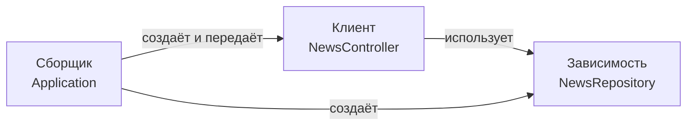
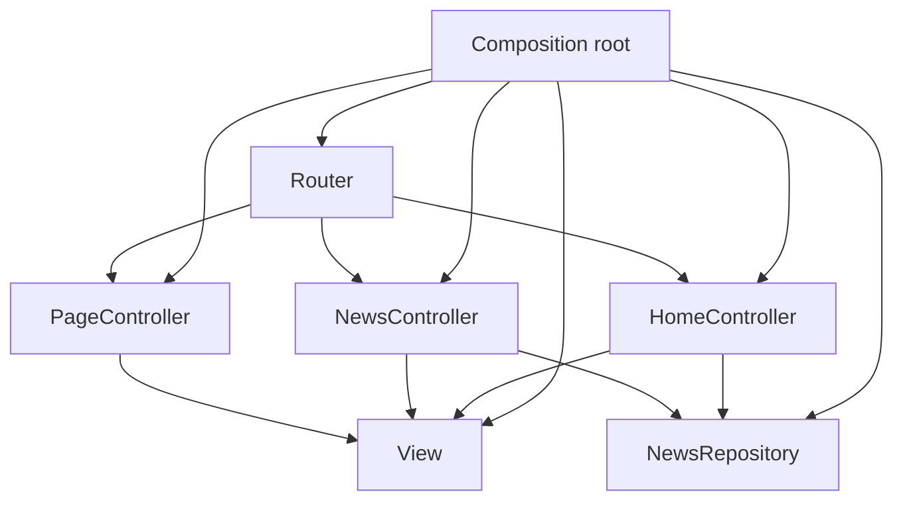
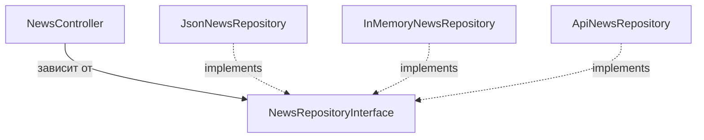
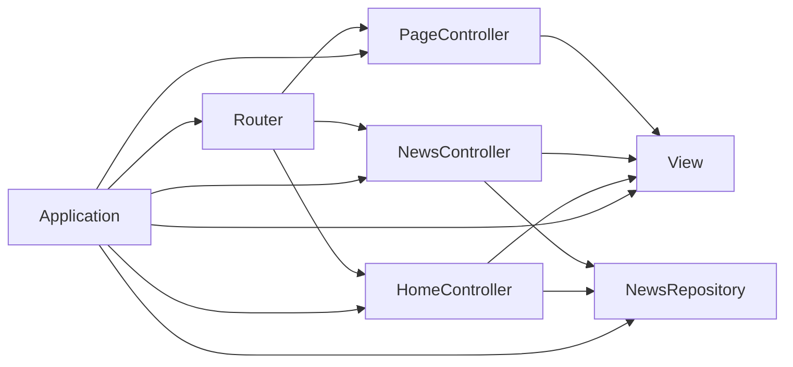
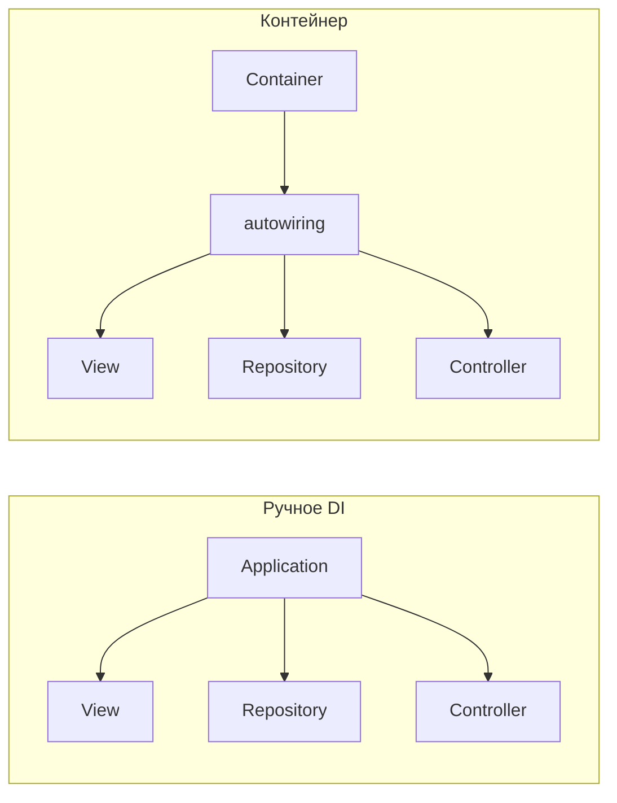
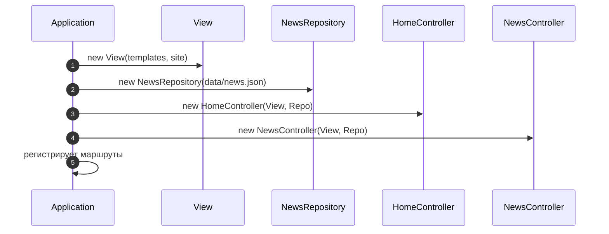
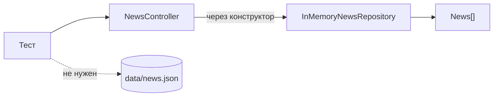

# Паттерн Dependency Injection (Внедрение зависимостей)

Дополнительный теоретический материал к работам 6–7. Он объясняет, что такое
**внедрение зависимостей**, почему это не синоним «контейнера» и как вручную собрать
приложение без магии и скрытых связей.

Материал рассчитан на **25–30 минут чтения**. Примеры написаны на PHP 8.3 и опираются
на код практикума: `Application` из работы 7, `app.php` и `CatalogRepository` из
работы 6.

| Раздел | Время |
|---|---|
| 1. Проблема скрытых зависимостей | 4 мин |
| 2. Что такое DI | 4 мин |
| 3. Composition root | 4 мин |
| 4. Интерфейсы и подмена реализаций | 3 мин |
| 5. Граф зависимостей и время жизни | 4 мин |
| 6. Контейнер и Service Locator | 4 мин |
| 7. DI в практикуме | 3 мин |
| 8. Тестирование | 3 мин |
| 9. Антипаттерны и границы | 3 мин |
| 10. Практика и упражнения | 3 мин |

---

## 1. Проблема скрытых зависимостей

### 1.1. Класс сам создаёт всё, что ему нужно

Представим контроллер новостей:

```php
<?php

declare(strict_types=1);

final class NewsController
{
    private NewsRepository $news;
    private View $view;

    public function __construct()
    {
        $this->news = new NewsRepository(__DIR__ . '/../../data/news.json');
        $this->view = new View(__DIR__ . '/../../templates', [
            'site' => require __DIR__ . '/../../config/site.php',
        ]);
    }

    public function show(string $slug): string
    {
        $news = $this->news->findBySlug($slug);

        return $this->view->render('news/show', ['news' => $news]);
    }
}
```

На первый взгляд удобно: создал контроллер — и всё работает. Но у этого кода есть
скрытые проблемы.

### 1.2. Чем плохо создавать зависимости внутри

1. **Класс знает слишком много.**
   `NewsController` знает путь к JSON-файлу, структуру конфига и папку шаблонов.
   Это уже не контроллер, а «сборщик всего приложения».

2. **Тесты требуют настоящих файлов.**
   Чтобы проверить `show()`, нужен реальный `news.json` и реальные шаблоны.

3. **Реализацию нельзя заменить.**
   Захотите подставить in-memory-репозиторий — придётся менять код контроллера.

4. **Зависимости спрятаны.**
   По сигнатуре `__construct()` не видно, что классу нужны репозиторий и View.
   Чем больше таких скрытых `new`, тем сложнее понять приложение.

5. **Появляются циклические связи.**
   Если классы создают друг друга напрямую, легко получить замкнутый круг, который
   невозможно собрать.

### 1.3. Что хочется получить

Хорошо, когда зависимости **видны в конструкторе** и приходят готовыми:

```php
final class NewsController
{
    public function __construct(
        private readonly View $view,
        private readonly NewsRepository $news,
    ) {
    }
}
```

Теперь по одной строке понятно:

- контроллеру нужен View;
- контроллеру нужен репозиторий новостей;
- контроллер сам ничего не создаёт;
- в тесте можно передать другие объекты.

Именно это и делает **Dependency Injection**.

---

## 2. Что такое DI

### 2.1. Определение

**Dependency Injection (DI, внедрение зависимостей)** — это подход, при котором объект
не создаёт свои зависимости самостоятельно, а получает их извне.

Зависимость — это всё, что нужно объекту для работы:

- репозиторий;
- View;
- HTTP-клиент;
- логгер;
- конфигурация;
- часы или генератор случайных чисел.

Внедрение означает, что кто-то снаружи создаёт эти объекты и передаёт их внутрь.

### 2.2. Три участника



- **Клиент** — объект, которому нужна зависимость.
- **Зависимость** — объект, который клиент использует.
- **Сборщик** — код, который создаёт оба объекта и связывает их.

В небольших приложениях роль сборщика выполняет один файл или класс `Application`.
В больших — контейнер зависимостей.

### 2.3. Виды внедрения

| Вид | Как выглядит | Когда использовать |
|---|---|---|
| **Constructor injection** | зависимости в `__construct()` | основной вариант: объект всегда готов к работе |
| **Method injection** | зависимость передаётся в конкретный метод | зависимость нужна только одному действию |
| **Property injection** | зависимость записывается в публичное свойство | редко, обычно только во фреймворках |
| **Interface injection** | объект реализует интерфейс с методом установки зависимости | почти не используется в PHP-приложениях |

В практикуме применяется **constructor injection**.

```php
final class HomeController extends Controller
{
    public function __construct(
        View $view,
        private readonly NewsRepository $news,
    ) {
        parent::__construct($view);
    }
}
```

### 2.4. Что DI не делает

- Не создаёт объекты автоматически сам по себе.
- Не требует контейнера.
- Не отменяет интерфейсы и фабрики.
- Не гарантирует хорошую архитектуру: можно внедрять зависимости и всё равно
  получить запутанный код.

DI — это прежде всего **способ передать зависимости явно**.

---

## 3. Composition root

### 3.1. Где собирать приложение

**Composition root** («корень сборки») — это место, где создаются все основные
объекты и связываются между собой. Обычно это один файл или один класс на всё
приложение.

В работе 7 это [`Application`](../pr7/solution/src/Application.php):

```php
final class Application
{
    private readonly View $view;
    private readonly Router $router;

    public function __construct(private readonly string $basePath)
    {
        $site = require $basePath . '/config/site.php';

        $this->view = new View($basePath . '/templates', ['site' => $site]);
        $repository = new NewsRepository($basePath . '/data/news.json');

        $home = new HomeController($this->view, $repository);
        $news = new NewsController($this->view, $repository);
        $pages = new PageController($this->view);

        $this->router = (new Router())->setStrategy(new ApplicationStrategy());

        $this->router->get('/', [$home, 'index']);
        $this->router->get('/news', [$news, 'index']);
        $this->router->get('/news/{slug:slug}', [$news, 'show']);
        $this->router->get('/about', [$pages, 'about']);
        $this->router->get('/contacts', [$pages, 'contacts']);
    }
}
```

Здесь видно весь граф:

- `View` создаётся один раз и передаётся всем контроллерам;
- `NewsRepository` создаётся один раз и используется двумя контроллерами;
- `PageController` не получает репозиторий, потому что он ему не нужен;
- контроллеры не знают, откуда взялись их зависимости.

### 3.2. Composition root в работе 6

В работе 6 сборка вынесена в [`pr6/solution/app.php`](../pr6/solution/app.php):

```php
$storage = new JsonFileStorage(__DIR__ . '/data/catalog.json');
$repository = new CatalogRepository($storage);
$validator = new ProductValidator();
```

Страницы подключают этот файл и получают готовые `$repository` и `$validator`.
Создание объектов отделено от их использования.

### 3.3. Ручное DI против контейнера

| Подход | Плюсы | Минусы |
|---|---|---|
| **Ручное DI** | видно весь граф, нет магии, легко отлаживать | больше `new` в одном месте |
| **DI-контейнер** | автоматическая сборка, удобно в больших проектах | скрытая конфигурация, сложнее понять порядок создания |

Для проекта из десяти классов ручное DI почти всегда проще. Контейнер начинает
окупаться, когда объектов становятся сотни и появляются разные окружения.



---

## 4. Интерфейсы и подмена реализаций

### 4.1. Зависимость от интерфейса

Если контроллер зависит от конкретного `JsonNewsRepository`, заменить хранилище
сложнее. Лучше зависеть от контракта:

```php
<?php

declare(strict_types=1);

namespace App\Repository;

use App\Model\News;

interface NewsRepositoryInterface
{
    /** @return News[] */
    public function all(): array;

    /** @return News[] */
    public function latest(int $limit = 3): array;

    public function findBySlug(string $slug): ?News;
}
```

```php
final class NewsController extends Controller
{
    public function __construct(
        View $view,
        private readonly NewsRepositoryInterface $news,
    ) {
        parent::__construct($view);
    }
}
```

Теперь контроллеру всё равно, JSON это, in-memory-массив или удалённый API.

### 4.2. Подмена в тесте

```php
$repository = new InMemoryNewsRepository([
    new News(
        id: 1,
        slug: 'test-news',
        title: 'Тестовая новость',
        category: NewsCategory::Company,
        excerpt: 'Короткое описание',
        body: 'Текст новости',
        publishedAt: new DateTimeImmutable('2026-01-02'),
    ),
]);

$controller = new NewsController($view, $repository);
```

Контроллер не изменился. Изменилась только реализация зависимости.

### 4.3. Принцип инверсии зависимостей

DI часто путают с **Dependency Inversion Principle** (DIP) — принципом из SOLID.
Это связанные, но разные вещи:

- **DIP** говорит: высокоуровневый код не должен зависеть от низкоуровневого;
  оба должны зависеть от абстракций.
- **DI** говорит: зависимости нужно передавать снаружи, а не создавать внутри.

Можно применять DI без интерфейсов. Можно объявить интерфейс, но всё равно создать
реализацию внутри класса. Хороший результат получается, когда оба подхода работают
вместе.



---

## 5. Граф зависимостей и время жизни

### 5.1. Что такое граф зависимостей

Если изобразить все связи «кто кого использует», получится **граф зависимостей**.
У него есть направление: стрелка идёт от клиента к зависимости.



Этот граф полезно проверять:

- нет ли цикла;
- нет ли класса, который знает слишком много;
- не создаётся ли тяжёлый объект несколько раз;
- все ли зависимости видны в конструкторах.

### 5.2. Порядок сборки

Объекты создаются **снизу вверх**: сначала зависимости, потом те, кто их использует.

Неправильно:

```php
$controller = new NewsController();
// Внутри контроллера он сам создаёт репозиторий и View
```

Правильно:

```php
$view = new View($basePath . '/templates', ['site' => $site]);
$repository = new NewsRepository($basePath . '/data/news.json');
$controller = new NewsController($view, $repository);
```

### 5.3. Время жизни объектов

| Режим | Что значит | Пример |
|---|---|---|
| **Transient** | новый объект при каждом запросе | фабрика, DTO, запрос |
| **Singleton / shared** | один объект на всё приложение | конфигурация, подключение к БД |
| **Request scope** | один объект на HTTP-запрос | текущий пользователь, логгер запроса |

В `pr7` `View` и `NewsRepository` создаются один раз в `Application` и передаются
контроллерам. Для учебного приложения это удобно и безопасно: они не хранят
изменяемого состояния между запросами.

Важно: **singleton — это не глобальная переменная**. Речь о том, что один и тот же
экземпляр передаётся нескольким клиентам в пределах одного процесса.

### 5.4. Циклические зависимости

Цикл выглядит так:

```text
A нужен B
B нужен C
C нужен A
```

Собрать такой граф через конструкторы невозможно: для создания `A` нужен `B`, для
`B` — `C`, для `C` — снова `A`.

Что делать:

1. Найти класс, который делает слишком много, и разделить ответственность.
2. Вынести общую часть в третий класс.
3. Передать зависимость не в конструктор, а в конкретный метод, если она нужна
   только для одного действия.
4. Использовать событие или callback вместо прямой связи.

Циклическая зависимость почти всегда сигнал о проблеме в дизайне, а не о том, что
нужен «умный контейнер».

---

## 6. Контейнер и Service Locator

### 6.1. Что такое DI-контейнер

**DI-контейнер** — это объект, который умеет создавать зависимости по запросу.
Стандарт **PSR-11** описывает минимальный интерфейс контейнера:

```php
interface ContainerInterface
{
    public function get(string $id): mixed;
    public function has(string $id): bool;
}
```

Современные контейнеры умеют **автоматическое связывание** (autowiring): смотрят на
типы в конструкторе и создают нужные объекты рекурсивно.

В этой работе контейнер **не используется**. Это осознанное решение: для небольшого
проекта явная сборка понятнее.

### 6.2. Когда контейнер оправдан

- объектов много и ручная сборка становится огромной;
- есть несколько окружений с разными реализациями;
- нужны общие настройки, декораторы, теги и ленивое создание;
- в проекте уже есть принятый стандарт (например, PSR-11).

### 6.3. Service Locator — антипаттерн

**Service Locator** — это когда класс не получает зависимости в конструкторе, а
сам достаёт их из контейнера:

```php
final class NewsController
{
    public function __construct(private readonly ContainerInterface $container)
    {
    }

    public function show(string $slug): string
    {
        $repository = $this->container->get(NewsRepository::class);
        $view = $this->container->get(View::class);
        // ...
    }
}
```

Чем это плохо:

- зависимости не видны в сигнатуре;
- класс можно создать, но он упадёт при вызове;
- тесты вынуждены собирать контейнер;
- контейнер превращается в глобальный реестр.

Контейнер можно передать в **composition root**, но не в бизнес-классы.

### 6.4. Контейнер против ручного DI



Оба варианта могут быть правильными. Ошибка начинается тогда, когда контейнер
начинают протаскивать в каждый класс или использовать как глобальную переменную.

---

## 7. DI в практикуме

### 7.1. Работа 7

| Файл | Что показывает |
|---|---|
| [`pr7/solution/src/Application.php`](../pr7/solution/src/Application.php) | composition root: создаёт View, NewsRepository, контроллеры и Router |
| [`pr7/solution/src/Controller/Controller.php`](../pr7/solution/src/Controller/Controller.php) | базовый контроллер получает View |
| [`pr7/solution/src/Controller/HomeController.php`](../pr7/solution/src/Controller/HomeController.php) | получает View и NewsRepository |
| [`pr7/solution/src/Controller/PageController.php`](../pr7/solution/src/Controller/PageController.php) | получает только View |

`HomeController` не создаёт репозиторий сам:

```php
public function __construct(
    View $view,
    private readonly NewsRepository $news,
) {
    parent::__construct($view);
}
```

Создание происходит в `Application`:

```php
$repository = new NewsRepository($basePath . '/data/news.json');
$home = new HomeController($this->view, $repository);
```

### 7.2. Работа 6

[`CatalogRepository`](../pr6/solution/src/CatalogRepository.php) получает хранилище
через конструктор:

```php
public function __construct(private readonly StorageInterface $storage)
{
}
```

Это позволяет заменить `JsonFileStorage` на `CsvStorage` или `SqliteStorage`, не
меняя репозиторий. Сборка находится в
[`pr6/solution/app.php`](../pr6/solution/app.php).

### 7.3. Схема сборки



Контроллеры получают уже готовые объекты. Ни один из них не знает, как создавался
`View` или откуда взялся путь к JSON.

---

## 8. Тестирование

### 8.1. Замена зависимости

Главная выгода DI — возможность подставить другой объект:

```php
$repository = new InMemoryNewsRepository([
    new News(/* ... */),
]);

$controller = new NewsController($view, $repository);
$response = $controller->show($request, ['slug' => 'test-news']);

assert($response->getStatusCode() === 200);
```

Нет файловой системы, нет реального JSON, нет базы. Тест проверяет именно поведение
контроллера.

### 8.2. Проверка контракта

Если контроллер зависит от интерфейса, можно написать тест, который не зависит от
реализации:

```php
function makeController(NewsRepositoryInterface $repository): NewsController
{
    return new NewsController(new View(__DIR__ . '/templates'), $repository);
}
```

Один и тот же тест подходит для JSON-репозитория с временным файлом и для
in-memory-репозитория.

### 8.3. Как найти скрытые зависимости

Полезные признаки:

- в конструкторе есть `new` других сервисов;
- используются глобальные переменные или `require` внутри класса;
- класс обращается к файлам или `$_GET` напрямую;
- в тестах приходится создавать настоящие файлы;
- по сигнатуре конструктора непонятно, что нужно классу.



---

## 9. Антипаттерны и границы

### 9.1. Скрытые `new` в конструкторе

```php
// Плохо: зависимость создаётся внутри
public function __construct()
{
    $this->repository = new NewsRepository('/path/to/news.json');
}
```

```php
// Хорошо: зависимость приходит снаружи
public function __construct(
    private readonly NewsRepository $repository,
) {
}
```

### 9.2. Внедрение контейнера

```php
// Плохо: контейнер заменяет явные зависимости
public function __construct(private readonly ContainerInterface $container)
{
}
```

Лучше внедрять конкретные зависимости. Контейнер должен жить в composition root,
а не в каждом классе.

### 9.3. Слишком много зависимостей

Если у конструктора десять параметров, это сигнал, что класс делает слишком много.
Разделите его на несколько классов или вынесите часть работы в сервис.

### 9.4. Внедрение ради внедрения

Не нужно делать DI-контейнер для скрипта из двадцати строк и не нужно внедрять
объект, который создаётся и используется ровно один раз в одном методе.

DI оправдан, когда:

- зависимость нужно заменить в тесте;
- реализаций может быть несколько;
- класс используется в разных окружениях;
- важно видеть зависимости явно.

### 9.5. Property injection

```php
// Сомнительно: объект может остаться без зависимости
$controller = new NewsController();
$controller->repository = $repository;
```

Объект существует в неполном состоянии. Constructor injection лучше: к моменту
создания объект уже готов к работе.

### 9.6. Глобальные переменные и статические реестры

```php
// Плохо: зависимость спрятана в глобальном состоянии
$repository = $GLOBALS['repository'];
```

Такая зависимость не видна в сигнатуре, её сложно подменить и легко забыть
инициализировать.

---

## 10. Практика и упражнения

### 10.1. Вопросы для самопроверки

1. Чем DI отличается от DI-контейнера?
2. Почему constructor injection считается предпочтительным?
3. Что такое composition root и где он находится в `pr7`?
4. Почему классу лучше зависеть от интерфейса, а не от реализации?
5. Чем Service Locator хуже обычного внедрения через конструктор?
6. Когда DI-контейнер действительно полезен?
7. Почему циклическая зависимость — признак проблемы в дизайне?
8. В каких случаях DI только усложняет код?

### 10.2. Упражнения

#### Упражнение 1. Найти скрытые зависимости

Откройте контроллеры `pr7` и найдите все места, где объекты создаются через `new`.
Перенесите создание в `Application`.

**Критерий:** в контроллерах нет `new NewsRepository(...)` и `new View(...)`.

#### Упражнение 2. Выделить интерфейс

Создайте `NewsRepositoryInterface` и передавайте в контроллеры его, а не конкретный
`NewsRepository`.

**Критерий:** в конструкторах контроллеров указан интерфейс; `Application` создаёт
конкретную реализацию.

#### Упражнение 3. Подставить fake

Создайте `InMemoryNewsRepository` и напишите тест контроллера без файлов.

**Критерий:** тест не читает `data/news.json` и не создаёт временных файлов.

#### Упражнение 4. Собрать граф вручную

Нарисуйте граф зависимостей своего приложения: кто кого создаёт и кто кого
использует. Найдите циклы и лишние связи.

**Критерий:** на схеме нет циклов, а у каждого класса не больше трёх-четырёх
зависимостей.

#### Упражнение 5. Заменить реализацию

Сделайте второй репозиторий с тем же интерфейсом и подставьте его в `Application`
без изменения контроллеров.

**Критерий:** контроллеры и шаблоны не изменились.

#### Упражнение 6. Убрать Service Locator

Если в коде есть класс, который получает контейнер и достаёт зависимости через
`get()`, замените это на явные зависимости в конструкторе.

**Критерий:** бизнес-классы не знают про контейнер.

### 10.3. Итоговый чек-лист

- [ ] Зависимости видны в конструкторах.
- [ ] Классы не создают сервисы через `new` внутри себя.
- [ ] Composition root один и находится на верхнем уровне.
- [ ] Контроллеры зависят от интерфейсов там, где нужна замена реализации.
- [ ] В тестах можно подставить fake-зависимость.
- [ ] Контейнер не передаётся в бизнес-классы.
- [ ] Нет циклических зависимостей.
- [ ] Нет глобальных реестров и скрытых `$GLOBALS`.
- [ ] У классов нет десятка зависимостей «на всякий случай».
- [ ] DI применяется там, где он упрощает код, а не ради самого паттерна.

---

## 11. Короткий итог

Dependency Injection — это не библиотека и не обязательно контейнер. Это правило:
**зависимости передаются снаружи и видны в контракте класса**.

В практикуме DI уже используется:

- контроллеры получают `View` и репозиторий через конструктор;
- `CatalogRepository` получает `StorageInterface`;
- `Application` и `app.php` собирают объекты в одном месте.

Следующий шаг — зависеть от интерфейсов, подставлять fake-реализации в тестах и
следить, чтобы создание объектов не пряталось внутри бизнес-классов.
