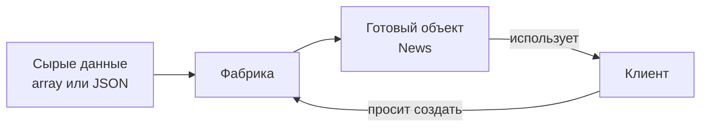
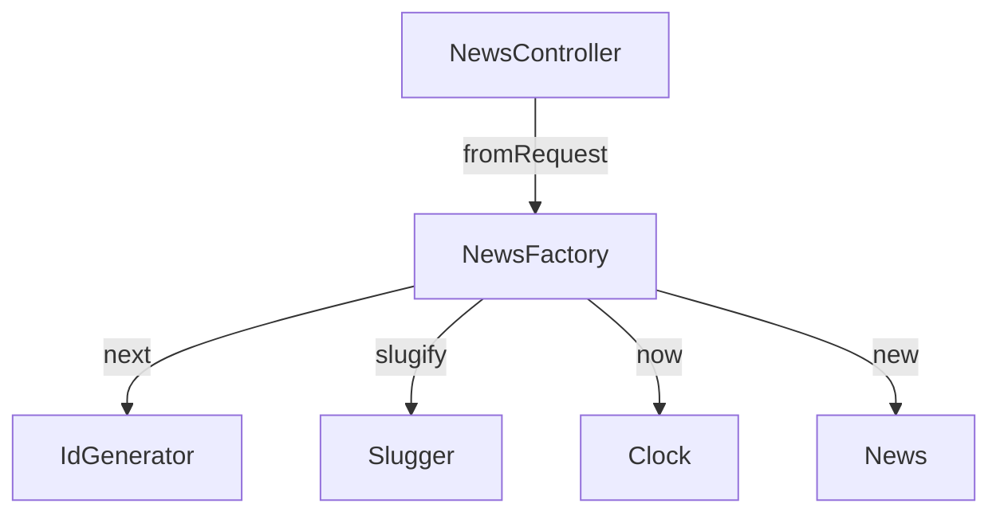
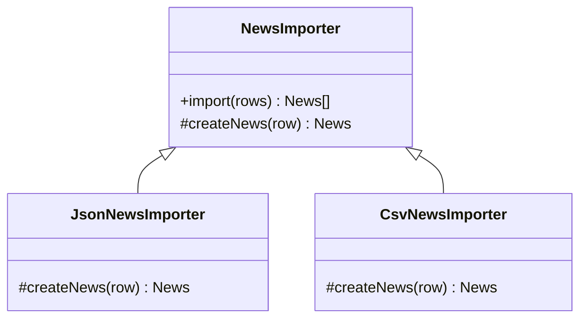
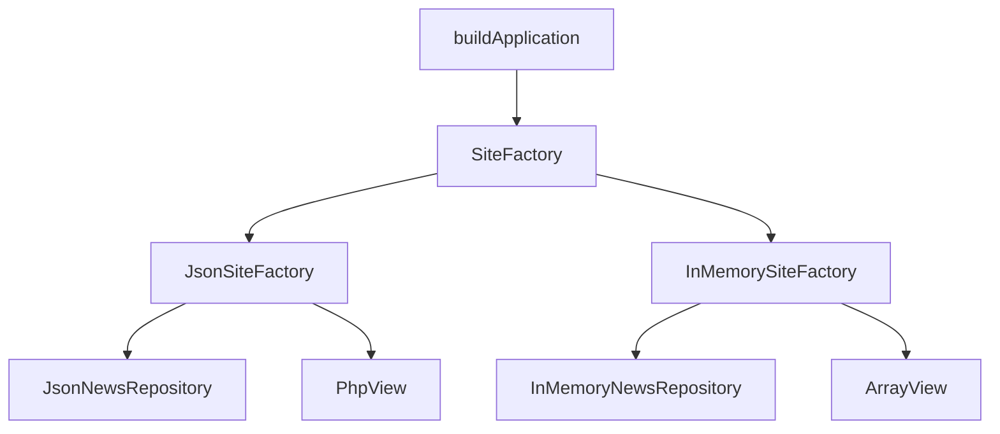
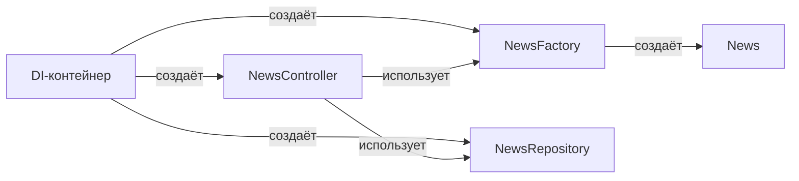

# Паттерн Factory (Фабрика)

Дополнительный теоретический материал к работам 6–7. Он объясняет, зачем нужны
фабрики, чем статическая фабрика отличается от Factory Method и Abstract Factory,
и как применять этот паттерн, не превращая код в набор лишних обёрток.

Материал рассчитан на **25–30 минут чтения**. Примеры написаны на PHP 8.3 и опираются
на код практикума: `Product::fromArray()` из работы 6, `News::fromArray()` из работы 7
и `CatalogRepository::makeProduct()`.

| Раздел | Время |
|---|---|
| 1. Проблема создания объектов | 4 мин |
| 2. Что такое фабрика | 4 мин |
| 3. Статическая фабрика и named constructors | 4 мин |
| 4. Простая фабрика | 4 мин |
| 5. Factory Method | 3 мин |
| 6. Abstract Factory | 3 мин |
| 7. Фабрика в практикуме | 3 мин |
| 8. Фабрика, валидация и DI | 4 мин |
| 9. Антипаттерны и границы | 3 мин |
| 10. Практика и упражнения | 3 мин |

---

## 1. Проблема создания объектов

### 1.1. Создание объекта — тоже ответственность

Создать объект бывает просто:

```php
$date = new DateTimeImmutable('2026-01-02');
```

А бывает сложно:

```php
$news = new News(
    id: (int) ($row['id'] ?? 0),
    slug: trim((string) ($row['slug'] ?? '')),
    title: trim((string) ($row['title'] ?? '')),
    category: NewsCategory::tryFrom((string) ($row['category'] ?? '')) ?? NewsCategory::Company,
    excerpt: trim((string) ($row['excerpt'] ?? '')),
    body: trim((string) ($row['body'] ?? '')),
    publishedAt: new DateTimeImmutable((string) ($row['published_at'] ?? 'now')),
);
```

Здесь смешаны сразу несколько задач:

- чтение сырых данных;
- приведение типов;
- обработка отсутствующих полей;
- выбор категории по умолчанию;
- разбор даты;
- создание объекта.

Если такой код повторяется в контроллере, репозитории и импорте, рано или поздно
копии начнут расходиться.

### 1.2. Чем плохо создавать сложные объекты везде

1. **Дублирование.** Одинаковое преобразование массива в объект повторяется в
   нескольких местах.
2. **Разные правила.** В одном месте дата парсится как `Y-m-d`, в другом — через
   `new DateTimeImmutable()`, и поведение отличается.
3. **Сложно менять.** Добавили новое обязательное поле — нужно найти все `new`.
4. **Клиент знает лишнее.** Контроллеру приходится знать, как устроен формат JSON
   и какие значения допустимы.
5. **Трудно тестировать.** Логика создания перемешана с логикой работы.

### 1.3. Что хочется получить

Хочется одну точку, где объект собирается правильно:

```php
$news = News::fromArray($row);
```

Клиент говорит: «сделай мне новость из этих данных». Как именно это происходит —
его не волнует.



---

## 2. Что такое фабрика

### 2.1. Определение

**Фабрика** — это код, который берёт на себя создание объектов и скрывает от
клиента детали их сборки.

Фабрика может быть:

- статическим методом класса;
- отдельным классом;
- методом в интерфейсе;
- семейством классов.

Общее одно: клиент не пишет сложный `new` самостоятельно, а обращается к фабрике.

### 2.2. Что фабрика не делает

Фабрика не обязана:

- быть отдельным классом;
- возвращать только один тип;
- заменять репозиторий;
- заменять DI-контейнер;
- быть универсальной «на все случаи жизни».

Фабрика отвечает именно за **создание**.

### 2.3. Фабрика и репозиторий

Это разные роли:

| Компонент | Ответственность |
|---|---|
| **Репозиторий** | найти, сохранить, удалить объекты |
| **Фабрика** | создать объект из входных данных |
| **DI** | передать готовые зависимости |

Репозиторий может использовать фабрику внутри:

```php
$product = Product::fromArray($row);
```

Но репозиторий не становится фабрикой: он всё равно отвечает за загрузку и
сохранение, а не за правила создания.

---

## 3. Статическая фабрика и named constructors

### 3.1. Статический метод вместо сложного конструктора

Самый простой вид фабрики — статический метод класса:

```php
final readonly class News
{
    public function __construct(
        public int $id,
        public string $slug,
        public string $title,
        public NewsCategory $category,
        public string $excerpt,
        public string $body,
        public DateTimeImmutable $publishedAt,
    ) {
    }

    public static function fromArray(array $row): self
    {
        $category = NewsCategory::tryFrom((string) ($row['category'] ?? ''));

        if ($category === null) {
            throw new InvalidArgumentException('Неизвестная категория новости');
        }

        $publishedAt = DateTimeImmutable::createFromFormat(
            '!Y-m-d',
            (string) ($row['published_at'] ?? '')
        );

        if ($publishedAt === false) {
            throw new InvalidArgumentException('Дата новости должна быть в формате YYYY-MM-DD');
        }

        return new self(
            id: (int) ($row['id'] ?? 0),
            slug: trim((string) ($row['slug'] ?? '')),
            title: trim((string) ($row['title'] ?? '')),
            category: $category,
            excerpt: trim((string) ($row['excerpt'] ?? '')),
            body: trim((string) ($row['body'] ?? '')),
            publishedAt: $publishedAt,
        );
    }
}
```

Вызов:

```php
$news = News::fromArray($row);
```

Такой метод называют **статической фабрикой** или **named constructor**
(«именованный конструктор»).

### 3.2. Почему это удобно

- Имя метода объясняет смысл: `fromArray`, `fromJson`, `fromRequest`.
- Можно вернуть `self` или другой совместимый тип.
- Можно выполнить проверки до создания объекта.
- Конструктор остаётся простым и принимает уже готовые значения.
- Вызов читается как «создай из массива», а не «передай семь аргументов».

### 3.3. Другие named constructors

```php
final readonly class News
{
    public static function fromForm(array $form, int $id): self
    {
        return new self(
            id: $id,
            slug: trim((string) ($form['slug'] ?? '')),
            title: trim((string) ($form['title'] ?? '')),
            category: NewsCategory::from((string) ($form['category'] ?? '')),
            excerpt: trim((string) ($form['excerpt'] ?? '')),
            body: trim((string) ($form['body'] ?? '')),
            publishedAt: new DateTimeImmutable(),
        );
    }

    public static function fromJson(string $json): self
    {
        $row = json_decode($json, true, flags: JSON_THROW_ON_ERROR);

        if (!is_array($row)) {
            throw new InvalidArgumentException('JSON должен содержать объект');
        }

        return self::fromArray($row);
    }
}
```

Использование:

```php
$news = News::fromForm($form, 42);
$fromJson = News::fromJson($json);
```

### 3.4. Ограничения статических фабрик

- Их нельзя подменить через DI: вызов `News::fromArray()` жёстко привязан к классу.
- Они плохо подходят, если для создания нужны зависимости: репозиторий, логгер,
  генератор идентификаторов.
- Статический метод не должен ходить в базу данных или файловую систему.

Статическая фабрика — хороший инструмент для **простого преобразования данных**.
Если создание требует внешних сервисов, лучше сделать обычный класс фабрики и
внедрить его как зависимость.

---

## 4. Простая фабрика

### 4.1. Отдельный класс

**Простая фабрика** (Simple Factory) — это класс с методом, который создаёт нужный
объект:

```php
final class NewsFactory
{
    public function fromArray(array $row): News
    {
        return News::fromArray($row);
    }

    public function fromRequest(ServerRequestInterface $request, int $id): News
    {
        $body = (array) $request->getParsedBody();

        return News::fromArray([
            'id' => $id,
            'slug' => $body['slug'] ?? '',
            'title' => $body['title'] ?? '',
            'category' => $body['category'] ?? '',
            'excerpt' => $body['excerpt'] ?? '',
            'body' => $body['body'] ?? '',
            'published_at' => $body['published_at'] ?? '',
        ]);
    }
}
```

Идентификатор передаёт вызывающий код: при обновлении он уже известен из маршрута,
а при создании его выделяет репозиторий. Контроллеру не нужно знать, как устроен
HTTP-запрос или JSON:

```php
$news = $this->factory->fromRequest($request, (int) $args['id']);
```

### 4.2. Фабрика с зависимостями

Если при создании нужен генератор идентификаторов или часы, их можно внедрить:

```php
final class NewsFactory
{
    public function __construct(
        private readonly IdGenerator $ids,
        private readonly Slugger $slugger,
        private readonly Clock $clock,
    ) {
    }

    public function fromRequest(ServerRequestInterface $request): News
    {
        $body = (array) $request->getParsedBody();
        $title = trim((string) ($body['title'] ?? ''));

        return new News(
            id: $this->ids->next(),
            slug: $this->slugger->slugify($title),
            title: $title,
            category: NewsCategory::from((string) ($body['category'] ?? '')),
            excerpt: trim((string) ($body['excerpt'] ?? '')),
            body: trim((string) ($body['body'] ?? '')),
            publishedAt: $this->clock->now(),
        );
    }
}
```

Здесь фабрика сама получает зависимости через конструктор. Это уже не статический
метод, и его легко заменить в тесте.

### 4.3. Схема простой фабрики



Простая фабрика не является отдельным паттерном GoF, но на практике используется
очень часто.

---

## 5. Factory Method

### 5.1. Идея

**Factory Method** — паттерн, при котором базовый класс определяет общий алгоритм,
а создание конкретного объекта выносится в метод, который переопределяют наследники.

Пример: импорт новостей из разных форматов.

```php
abstract class NewsImporter
{
    /** @return News[] */
    final public function import(array $rows): array
    {
        $result = [];

        foreach ($rows as $row) {
            $result[] = $this->createNews($row);
        }

        return $result;
    }

    abstract protected function createNews(array $row): News;
}
```

```php
final class JsonNewsImporter extends NewsImporter
{
    protected function createNews(array $row): News
    {
        return News::fromArray($row);
    }
}
```

```php
final class CsvNewsImporter extends NewsImporter
{
    protected function createNews(array $row): News
    {
        return News::fromArray([
            'id' => $row[0] ?? 0,
            'slug' => $row[1] ?? '',
            'title' => $row[2] ?? '',
            'category' => $row[3] ?? '',
            'excerpt' => $row[4] ?? '',
            'body' => $row[5] ?? '',
            'published_at' => $row[6] ?? '',
        ]);
    }
}
```

Клиент работает с общим `NewsImporter`:

```php
function importNews(NewsImporter $importer, array $rows): array
{
    return $importer->import($rows);
}
```

`import()` задаёт порядок действий, а `createNews()` — точка расширения.

### 5.2. Когда нужен Factory Method

- есть общий алгоритм, но разные способы создания объектов;
- хочется расширять поведение без изменения базового класса;
- количество вариантов известно и стабильно;
- варианты отличаются именно созданием, а не всей логикой.

### 5.3. Схема Factory Method



### 5.4. Factory Method и простая фабрика

| Критерий | Простая фабрика | Factory Method |
|---|---|---|
| Где создание | в одном классе, часто через `switch` | в наследниках |
| Расширение | изменить фабрику | добавить новый класс |
| Сложность | низкая | выше |
| Когда использовать | небольшое число вариантов | нужна расширяемая иерархия |

---

## 6. Abstract Factory

### 6.1. Идея

**Abstract Factory** создаёт не один объект, а **семейство связанных объектов**.
Например, для разных окружений нужны разные реализации репозитория и View.

```php
interface SiteFactory
{
    public function createNewsRepository(): NewsRepositoryInterface;
    public function createView(): ViewInterface;
}
```

```php
final class JsonSiteFactory implements SiteFactory
{
    public function __construct(private readonly string $basePath)
    {
    }

    public function createNewsRepository(): NewsRepositoryInterface
    {
        return new JsonNewsRepository($this->basePath . '/data/news.json');
    }

    public function createView(): ViewInterface
    {
        return new PhpView($this->basePath . '/templates');
    }
}
```

```php
final class InMemorySiteFactory implements SiteFactory
{
    public function createNewsRepository(): NewsRepositoryInterface
    {
        return new InMemoryNewsRepository();
    }

    public function createView(): ViewInterface
    {
        return new ArrayView();
    }
}
```

Клиент получает одну фабрику и создаёт согласованный набор объектов:

```php
function buildApplication(SiteFactory $factory): void
{
    $repository = $factory->createNewsRepository();
    $view = $factory->createView();
    // ...
}
```

### 6.2. Когда Abstract Factory оправдана

- есть несколько семейств объектов;
- объекты внутри семейства должны быть совместимы;
- нужно переключать всё семейство целиком;
- клиент не должен знать конкретные классы.

### 6.3. Почему она редко нужна в учебном проекте

Abstract Factory добавляет много интерфейсов и классов. Для небольшого сайта проще
собрать объекты в composition root:

```php
$repository = new JsonNewsRepository($basePath . '/data/news.json');
$view = new PhpView($basePath . '/templates');
```

Паттерн стоит применять, когда семейств действительно несколько.

### 6.4. Схема Abstract Factory



---

## 7. Фабрика в практикуме

### 7.1. `Product::fromArray()`

В работе 6 есть статическая фабрика
[`pr6/solution/src/Product.php`](../pr6/solution/src/Product.php):

```php
public static function fromArray(array $row): self
{
    return new self(
        id: (int) ($row['id'] ?? 0),
        title: (string) ($row['title'] ?? ''),
        category: Category::tryFrom((string) ($row['category'] ?? '')) ?? Category::Tech,
        price: (float) ($row['price'] ?? 0),
        stock: (int) ($row['stock'] ?? 0),
        discount: (int) ($row['discount'] ?? 0),
    );
}
```

Она используется в репозитории:

```php
$products = array_map(
    fn (array $row): Product => Product::fromArray($row),
    $this->storage->load()
);
```

Репозиторий не создаёт товар вручную — он делегирует создание фабрике.

### 7.2. `News::fromArray()`

В работе 7 есть более строгая версия
[`pr7/solution/src/Model/News.php`](../pr7/solution/src/Model/News.php). Она проверяет
категорию и формат даты и бросает `InvalidArgumentException` при ошибке.

Это хороший пример того, как фабрика защищает инварианты объекта:

```php
$category = NewsCategory::tryFrom((string) ($row['category'] ?? ''));

if ($category === null) {
    throw new InvalidArgumentException('Неизвестная категория новости');
}
```

### 7.3. `CatalogRepository::makeProduct()`

В [`pr6/solution/src/CatalogRepository.php`](../pr6/solution/src/CatalogRepository.php)
есть приватный метод:

```php
private function makeProduct(int $id, array $input): Product
{
    return new Product(
        id: $id,
        title: trim((string) ($input['title'] ?? '')),
        category: Category::from((string) ($input['category'] ?? '')),
        price: (float) ($input['price'] ?? 0),
        stock: (int) ($input['stock'] ?? 0),
        discount: (int) ($input['discount'] ?? 0),
    );
}
```

Это **фабричный метод**: он инкапсулирует создание `Product` из данных формы и
используется в `create()` и `update()`.

Такой метод полезен, когда:

- преобразование нужно только внутри одного класса;
- создание должно быть согласовано с логикой репозитория;
- отдельный публичный класс фабрики пока избыточен.

### 7.4. `ServerRequestFactory`

В работе 7 в [`pr7/solution/public/index.php`](../pr7/solution/public/index.php)
используется `Laminas\Diactoros\ServerRequestFactory` — пример фабрики из реальной
библиотеки:

```php
$request = ServerRequestFactory::fromGlobals(
    $_SERVER,
    $_GET,
    $_POST,
    $_COOKIE,
    $_FILES,
);
```

Клиенту не нужно вручную собирать `ServerRequest`. Библиотека берёт на себя
преобразование глобальных переменных в объект PSR-7. Это соответствует стандарту
[PSR-17](https://www.php-fig.org/psr/psr-17/), который описывает фабрики HTTP-объектов.

### 7.5. Что в практикуме не является фабрикой

`Application` создаёт объекты, но это **composition root**, а не фабрика:

- его задача — собрать всё приложение и связать зависимости;
- он не скрывает создание за общим интерфейсом;
- он не выбирает семейство объектов по типу.

Один класс может одновременно быть сборщиком и использовать фабрики, но роли
лучше не смешивать.

---

## 8. Фабрика, валидация и DI

### 8.1. Где проверять данные

Есть три разных уровня:

| Уровень | Что проверяет | Пример |
|---|---|---|
| **Форма** | обязательные поля, длина, формат | `ProductValidator` |
| **Фабрика** | можно ли собрать объект | корректная категория, дата |
| **Сущность** | инварианты объекта | цена не отрицательна |

Фабрика не заменяет валидатор формы. Она отвечает за то, чтобы результат был
корректным объектом.

```php
final class NewsFactory
{
    public function fromArray(array $row): News
    {
        $title = trim((string) ($row['title'] ?? ''));

        if ($title === '') {
            throw new InvalidArgumentException('Название новости обязательно');
        }

        return new News(
            // ...
            title: $title,
        );
    }
}
```

### 8.2. Фабрика и DI

Они решают разные задачи:

- **DI** поставляет зависимости, которые нужны классу для работы;
- **фабрика** создаёт новые объекты по входным данным.

Фабрику можно внедрить как зависимость:

```php
final class NewsController
{
    public function __construct(
        private readonly NewsFactory $factory,
        private readonly NewsRepositoryInterface $news,
    ) {
    }
}
```

Тогда в тесте можно подставить другую фабрику.

### 8.3. Фабрика внутри DI-контейнера

Контейнер умеет создавать сервисы, но не всегда умеет правильно собирать доменные
объекты из запроса. Поэтому в реальных приложениях часто есть и контейнер, и
фабрики:

- контейнер создаёт `NewsController`, `NewsFactory`, репозиторий;
- фабрика создаёт `News` из данных формы.



---

## 9. Антипаттерны и границы

### 9.1. Фабрика ради фабрики

```php
// Лишний слой: ничего не скрывает и не упрощает
final class UserFactory
{
    public function create(string $name): User
    {
        return new User($name);
    }
}
```

Если создание — это один `new` с простыми аргументами, фабрика чаще всего не нужна.

### 9.2. Фабрика, которая просто вызывает `new`

Обёртка оправдана, если:

- есть преобразование данных;
- есть проверки;
- создание может измениться;
- нужна возможность подмены;
- скрывается сложный набор аргументов.

Если ничего этого нет, лучше оставить прямой `new`.

### 9.3. Божественная фабрика

```php
// Плохо: одна фабрика создаёт всё подряд
final class EverythingFactory
{
    public function create(string $type): object
    {
        return match ($type) {
            'news' => new News(/* ... */),
            'user' => new User(/* ... */),
            'product' => new Product(/* ... */),
            'page' => new Page(/* ... */),
            default => throw new InvalidArgumentException('Неизвестный тип'),
        };
    }
}
```

Проблемы:

- один класс знает обо всех сущностях;
- `object` или общий интерфейс теряет типизацию;
- добавление типа требует правки фабрики;
- тестировать становится сложнее.

Лучше отдельные фабрики для разных задач.

### 9.4. `switch` вместо полиморфизма

Если вариантов много и они часто меняются, `switch` в фабрике разрастается.
В таких случаях помогает Factory Method или отдельные классы-стратегии.

Но не стоит бороться со `switch` там, где вариантов два и они стабильны. Простота
важнее следования паттерну.

### 9.5. Статическая фабрика с побочными эффектами

```php
// Плохо: фабрика не должна ходить в базу или файлы
public static function fromDatabase(int $id): self
{
    $row = Database::query('SELECT * FROM news WHERE id = ?', [$id]);
    return self::fromArray($row);
}
```

Статический метод сложно подменить и протестировать. Загрузку данных должен делать
репозиторий, а не фабрика сущности.

### 9.6. Фабрика, возвращающая `null`

Если объект создать нельзя, лучше бросить исключение или вернуть `null` осознанно,
но не смешивать оба подхода. В практикуме `fromArray()` бросает
`InvalidArgumentException`, потому что некорректные данные — ошибка вызывающего
кода.

---

## 10. Практика и упражнения

### 10.1. Вопросы для самопроверки

1. Чем фабрика отличается от репозитория?
2. Почему `News::fromArray()` называют named constructor?
3. Когда статическая фабрика удобна, а когда вредна?
4. Чем простая фабрика отличается от Factory Method?
5. Когда нужна Abstract Factory?
6. Почему фабрика не заменяет валидатор формы?
7. Как фабрика связана с DI?
8. Почему `Application` не является фабрикой?

### 10.2. Упражнения

#### Упражнение 1. Вынести создание новости

Создайте `NewsFactory` с методом `fromArray(array $row): News` и используйте его в
репозитории вместо прямого `News::fromArray()`.

**Критерий:** репозиторий не знает деталей преобразования, а фабрика покрыта тестом.

#### Упражнение 2. Добавить создание из запроса

Добавьте в `NewsFactory` метод `fromRequest(ServerRequestInterface $request, int $id): News`.

**Критерий:** контроллер не читает `$_POST` и не собирает массив вручную.

#### Упражнение 3. Вынести `makeProduct()`

Превратите приватный `CatalogRepository::makeProduct()` в отдельный
`ProductFactory`.

**Критерий:** `create()` и `update()` используют фабрику; тесты репозитория не
сломались.

#### Упражнение 4. Проверить ошибки

Напишите тесты для `NewsFactory::fromArray()`:

- неизвестная категория;
- пустой заголовок;
- неверный формат даты.

**Критерий:** каждый случай даёт понятное исключение, а не тихую подстановку
значения по умолчанию.

#### Упражнение 5. Сравнить подходы

Реализуйте создание новости двумя способами:

1. статический `News::fromArray()`;
2. внедряемый `NewsFactory`.

Сравните: что удобнее тестировать, что проще читать, где больше кода.

**Критерий:** есть вывод, в каких условиях каждый вариант лучше.

#### Упражнение 6. Добавить импорт

Сделайте `NewsImporter` с абстрактным `createNews()` и двумя наследниками:
`JsonNewsImporter` и `CsvNewsImporter`.

**Критерий:** общий алгоритм `import()` не дублируется, отличие только в
`createNews()`.

### 10.3. Итоговый чек-лист

- [ ] Создание сложных объектов не дублируется по проекту.
- [ ] Фабрика не смешивается с репозиторием и валидатором.
- [ ] Статическая фабрика используется только для простого преобразования данных.
- [ ] Фабрика с зависимостями получает их через конструктор.
- [ ] Простая фабрика не превращается в «божественную».
- [ ] Factory Method применяется, когда есть общий алгоритм и разные способы создания.
- [ ] Abstract Factory применяется только при наличии нескольких семейств объектов.
- [ ] Фабрика не ходит в базу данных и не выполняет HTTP-запросы.
- [ ] Ошибки создания явные: исключение или документированный `null`.
- [ ] Фабрика покрыта тестами на валидные и некорректные данные.

---

## 11. Короткий итог

Фабрика — это способ **отделить создание объекта от его использования**.

В практикуме уже есть несколько примеров:

- `Product::fromArray()` и `News::fromArray()` — статические фабрики;
- `CatalogRepository::makeProduct()` — приватный фабричный метод;
- `ServerRequestFactory` — фабрика из библиотеки;
- `Application` — не фабрика, а composition root.

Начинать стоит с простого: если создание объекта содержит преобразование данных или
проверки, вынесите его в named constructor. Если появляются зависимости и нужна
подмена — сделайте отдельный класс фабрики. Factory Method и Abstract Factory нужны
только тогда, когда действительно есть несколько вариантов создания или семейств
объектов.
