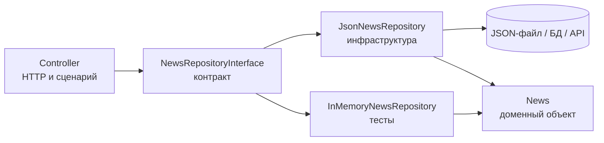
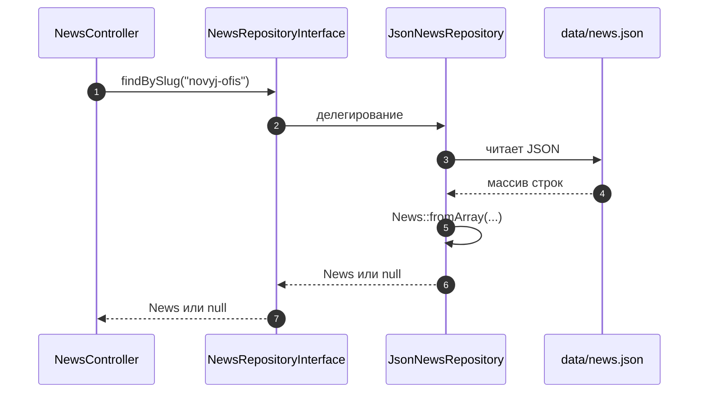
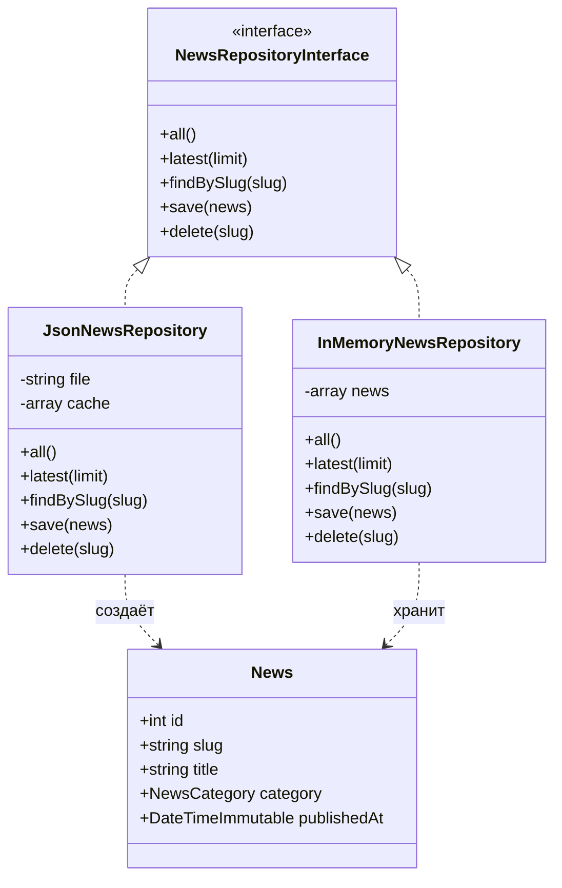
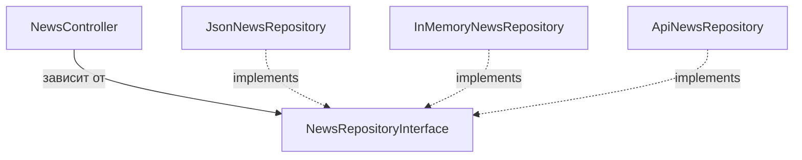
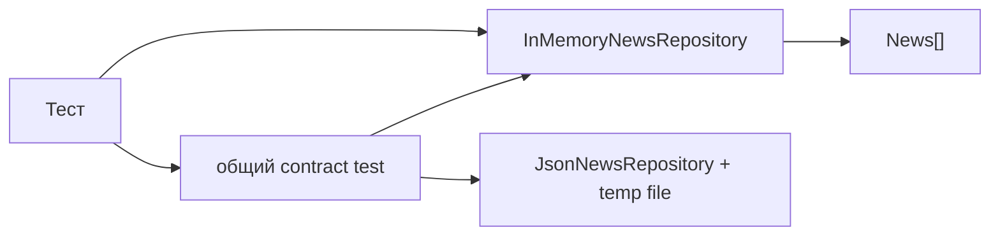

# Паттерн Repository (Репозиторий)

Дополнительный теоретический материал к работам 6–7. Он объясняет, зачем нужен
**репозиторий**, где проходит его граница ответственности и как не превратить полезный
паттерн в лишний слой.

Материал рассчитан на **25–30 минут чтения**. Примеры написаны на PHP 8.3 и
согласованы с кодом практикума: `CatalogRepository` из работы 6 и `NewsRepository`
из работы 7.

| Раздел | Время |
|---|---|
| 1. Проблема доступа к данным | 4 мин |
| 2. Что такое Repository | 4 мин |
| 3. Место в архитектуре | 3 мин |
| 4. Интерфейс и контракт | 4 мин |
| 5. Реализации | 4 мин |
| 6. Ошибки и запросы | 3 мин |
| 7. Тестирование | 3 мин |
| 8. Границы применимости | 3 мин |
| 9. Практика и упражнения | 3 мин |

---

## 1. Проблема доступа к данным

### 1.1. Как выглядит код без репозитория

В работах 1–5 доступ к данным был размазан по страницам. Упрощённый пример:

```php
<?php

$rows = json_decode(file_get_contents('data/news.json'), true);

$news = null;
foreach ($rows as $row) {
    if ($row['slug'] === $_GET['slug']) {
        $news = $row;
    }
}

if ($news === null) {
    http_response_code(404);
    exit('Новость не найдена');
}

echo '<h1>' . htmlspecialchars($news['title']) . '</h1>';
```

Пока страница одна, это работает. Как только появляются главная, список новостей,
админка и API, начинаются проблемы:

1. **Дублирование.** Чтение JSON и поиск по `slug` копируются в каждый контроллер.
2. **Связанность.** Контроллер знает формат файла, имена ключей и способ хранения.
3. **Сложность тестов.** Чтобы проверить страницу, нужен настоящий файл или база.
4. **Болезненная замена хранилища.** Переход с JSON на SQLite затрагивает все страницы.

### 1.2. Что хочется получить

Контроллеру нужно не «прочитать файл и найти строку», а ответить на вопрос предметной
области:

```php
$news = $repository->findBySlug('novyj-ofis');
$latest = $repository->latest(3);
```

Контроллер не должен знать:

- откуда пришли данные — из JSON, SQLite или HTTP-API;
- как называется файл и в каком он формате;
- как строка превращается в объект `News`;
- как сортируются даты.

Именно эту границу и описывает паттерн **Repository**.

---

## 2. Что такое Repository

### 2.1. Определение

**Repository (Репозиторий)** — это объект, который предоставляет доступ к доменным
объектам так, будто они хранятся в коллекции в памяти, и скрывает детали хранения.

Формально репозиторий:

- выступает посредником между **доменной моделью** и **слоем данных**;
- предоставляет методы на языке предметной области;
- возвращает **доменные объекты**, а не строки таблиц и не массивы JSON;
- берёт на себя преобразование данных туда и обратно;
- изолирует приложение от конкретного хранилища.

### 2.2. Аналогия

Представьте библиотеку. Читателю не нужно знать, на каком стеллаже лежит книга, как
устроен каталог и кто расставляет книги по вечерам. Он говорит библиотекарю:
«найдите книгу с таким названием». Библиотекарь — репозиторий: он знает, где и как
искать, но выдаёт читателю книгу, а не инструкцию по работе со стеллажом.

Другая аналогия — склад. Склад может быть файловым, табличным или удалённым. Для
приложения важен набор операций: «получить все», «найти по идентификатору»,
«сохранить», «удалить». Где именно лежит товар — деталь реализации.

### 2.3. Коллекционная семантика

Репозиторий старается выглядеть как коллекция:

```php
$news = $repository->all();          // все элементы
$item = $repository->findBySlug(...); // один элемент или null
$repository->save($item);            // сохранить элемент
$repository->delete($item);          // удалить элемент
```

Важно не то, что внутри находится массив. Важно, что снаружи репозиторий отвечает на
вопросы предметной области и не заставляет клиента работать с деталями хранения.

### 2.4. Ключевые признаки хорошего репозитория

- **Говорит на языке домена.** `latest()`, `findBySlug()`, `publishedIn()`, а не
  `selectWhere()` или `query()`.
- **Скрывает хранилище.** В сигнатурах нет `PDO`, `file_get_contents`, `SQL`.
- **Возвращает доменные объекты.** `News`, `Product`, `Catalog`, а не `array` строк.
- **Имеет узкий контракт.** Несколько осмысленных методов, а не универсальный
  «сделай любой запрос».
- **Не знает про HTTP.** В репозитории нет `$_GET`, `header()`, `Response`.
- **Не содержит бизнес-правил.** Он достаёт и сохраняет, но не решает, можно ли
  опубликовать новость.

### 2.5. Чем Repository не является

| Это не... | Почему |
|---|---|
| **ORM** | ORM — инструмент отображения объектов на таблицы. Репозиторий может использовать ORM внутри. |
| **ActiveRecord** | В ActiveRecord сущность сама умеет `save()`. В Repository сохранением занимается отдельный объект. |
| **DAO** | DAO обычно работает на уровне таблиц и строк, Repository — на уровне доменных объектов. |
| **Сервис** | Сервис содержит сценарии приложения и бизнес-правила, репозиторий — только доступ к данным. |
| **Query Builder** | Репозиторий не должен отдавать наружу конструктор запросов. |
| **Кэш** | Кэширование может быть внутри, но это не основная ответственность паттерна. |

---

## 3. Место в архитектуре

### 3.1. Слои



Контроллер зависит от **интерфейса**, а не от конкретного класса. Это проявление
принципа инверсии зависимостей: высокоуровневый код не должен зависеть от деталей
низкого уровня.

### 3.2. Кому принадлежит интерфейс

Есть два распространённых подхода:

1. **Интерфейс в доменном слое.** Домен объявляет, какие операции ему нужны, а
   инфраструктура их реализует. Это ближе к «чистой» архитектуре.
2. **Интерфейс рядом с реализацией.** Для небольшого учебного проекта допустимо
   держать `NewsRepositoryInterface` и `JsonNewsRepository` в одном пространстве имён.

В практикуме выбран второй вариант: `App\Repository`. Для работ 6–7 этого достаточно,
но полезно понимать направление зависимости: **домен задаёт контракт, инфраструктура
его выполняет**, а не наоборот.

### 3.3. Repository и MVC

В MVC репозиторий относится к **модели**, а не к контроллеру. Контроллер лишь вызывает
методы репозитория и передаёт результат во View.



Контроллер не знает, что внутри был JSON. Завтра `JsonNewsRepository` можно заменить
на `SqliteNewsRepository` или `ApiNewsRepository`, и контроллер не изменится.

---

## 4. Интерфейс и контракт

### 4.1. Пример интерфейса

```php
<?php

declare(strict_types=1);

namespace App\Repository;

use App\Model\News;

interface NewsRepositoryInterface
{
    /** @return News[] */
    public function all(): array;

    /** @return News[] */
    public function latest(int $limit = 3): array;

    public function findBySlug(string $slug): ?News;

    public function save(News $news): void;

    public function delete(string $slug): void;
}
```



### 4.2. Имена методов

Имена должны отражать предметную область, а не устройство базы:

| Хорошо | Плохо | Почему |
|---|---|---|
| `findBySlug()` | `selectBySlug()` | `select` выдаёт SQL-детали |
| `latest(3)` | `getLastThreeRows()` | второй вариант привязан к строкам |
| `publishedAfter()` | `whereDateGreater()` | язык домена понятнее |
| `save(News $news)` | `insertOrUpdate(array $row)` | репозиторий работает с объектом |

### 4.3. `find` против `get`

Полезно различать два сценария:

- **`findBy...()`** возвращает `?News` и `null`, если объект не найден. Это удобно,
  когда отсутствие — нормальная ситуация.
- **`getBy...()`** возвращает `News` или бросает исключение. Это удобно, когда объект
  обязателен для дальнейшей работы.

```php
public function findBySlug(string $slug): ?News;

public function getBySlug(string $slug): News;
```

Не смешивайте оба стиля в одном методе. Выберите правило и соблюдайте его во всём
репозитории.

В текущем `pr7` используется `findBySlug(): ?News`, а контроллер сам решает, что
делать с `null`:

```php
$news = $this->news->findBySlug($slug);

if ($news === null) {
    throw new NotFoundException('Новость не найдена');
}
```

Это допустимый вариант. Альтернатива — перенести решение в репозиторий через
`getBySlug()` и `NewsNotFoundException`.

### 4.4. Возвращаемые типы

Репозиторий должен возвращать доменные объекты:

```php
/** @return News[] */
public function all(): array;          // хорошо

public function all(): array;          // плохо, если внутри массивы строк
```

Если PHP не позволяет выразить «массив `News`» в сигнатуре, используйте PHPDoc.
Это помогает редактору и статическому анализатору.

### 4.5. Чего не должно быть в интерфейсе

- `PDO $pdo`, `string $table`, `string $sql`;
- `array $where`, `array $orderBy` как универсальный запрос;
- `Request $request`, `Response $response`;
- методы `render()`, `redirect()`, `validateForm()`;
- бизнес-методы вроде `publishIfAllowed()`.

Интерфейс должен описывать **доступ к данным**, а не всё приложение.

---

## 5. Реализации

### 5.1. JSON-репозиторий

Ниже — упрощённая реализация для новостей. Она похожа на
[`NewsRepository`](../pr7/solution/src/Repository/NewsRepository.php), но приведена
к интерфейсу и дополнена записью.

```php
<?php

declare(strict_types=1);

namespace App\Repository;

use App\Model\News;
use RuntimeException;

final class JsonNewsRepository implements NewsRepositoryInterface
{
    /** @var News[]|null */
    private ?array $cache = null;

    public function __construct(private readonly string $file)
    {
    }

    public function all(): array
    {
        return $this->load();
    }

    public function latest(int $limit = 3): array
    {
        if ($limit < 1) {
            return [];
        }

        $news = $this->load();
        usort(
            $news,
            fn (News $a, News $b): int => $b->publishedAt <=> $a->publishedAt
        );

        return array_slice($news, 0, $limit);
    }

    public function findBySlug(string $slug): ?News
    {
        foreach ($this->load() as $news) {
            if ($news->slug === $slug) {
                return $news;
            }
        }

        return null;
    }

    public function save(News $news): void
    {
        $items = $this->load();
        $replaced = false;

        foreach ($items as $index => $existing) {
            if ($existing->slug === $news->slug) {
                $items[$index] = $news;
                $replaced = true;
                break;
            }
        }

        if (!$replaced) {
            $items[] = $news;
        }

        $this->persist($items);
    }

    public function delete(string $slug): void
    {
        $items = array_values(array_filter(
            $this->load(),
            fn (News $news): bool => $news->slug !== $slug
        ));

        $this->persist($items);
    }

    /** @return News[] */
    private function load(): array
    {
        if ($this->cache !== null) {
            return $this->cache;
        }

        if (!is_file($this->file) || !is_readable($this->file)) {
            throw new RuntimeException('Файл новостей не найден');
        }

        $json = file_get_contents($this->file);

        if ($json === false) {
            throw new RuntimeException('Не удалось прочитать файл новостей');
        }

        $rows = json_decode($json, true);

        if (!is_array($rows) || !array_is_list($rows)) {
            throw new RuntimeException('Ожидался JSON-массив новостей');
        }

        $this->cache = array_map(
            fn (array $row): News => News::fromArray($row),
            $rows
        );

        return $this->cache;
    }

    /** @param News[] $news */
    private function persist(array $news): void
    {
        $rows = array_map(
            fn (News $item): array => [
                'id' => $item->id,
                'slug' => $item->slug,
                'title' => $item->title,
                'category' => $item->category->value,
                'excerpt' => $item->excerpt,
                'body' => $item->body,
                'published_at' => $item->publishedAt->format('Y-m-d'),
            ],
            $news
        );

        $json = json_encode($rows, JSON_PRETTY_PRINT | JSON_UNESCAPED_UNICODE);

        if ($json === false) {
            throw new RuntimeException('Не удалось преобразовать новости в JSON');
        }

        $bytes = @file_put_contents($this->file, $json, LOCK_EX);

        if ($bytes === false) {
            throw new RuntimeException('Не удалось записать файл новостей');
        }

        $this->cache = $news;
    }
}
```

Обратите внимание на два важных места:

1. **Преобразование данных** выполняется внутри репозитория: `News::fromArray()` и
   обратный массив в `persist()`. Снаружи видны только объекты `News`.
2. **Кэш инвалидируется при записи.** В текущем `pr7` репозиторий только читает данные,
   поэтому кэш безопасен. Если добавить `save()`/`delete()`, после записи нужно
   обновить или сбросить `$cache`, иначе следующий запрос вернёт устаревшие данные.

### 5.2. Репозиторий поверх `StorageInterface`

В работе 6 используется другой, тоже правильный подход:

```php
final class CatalogRepository
{
    public function __construct(private readonly StorageInterface $storage)
    {
    }

    public function load(): Catalog
    {
        $products = array_map(
            fn (array $row): Product => Product::fromArray($row),
            $this->storage->load()
        );

        return new Catalog($products);
    }

    public function save(Catalog $catalog): void
    {
        $this->storage->save(array_map(
            fn (Product $product): array => $product->toArray(),
            $catalog->all()
        ));
    }
}
```

Здесь разделение ещё точнее:

- `StorageInterface` отвечает за «сырые» строки;
- `CatalogRepository` превращает строки в доменные объекты и обратно;
- `Catalog` — коллекция товаров с операциями поиска и сортировки;
- `Product` — доменная сущность.

Такой вариант удобен, когда хранилищ несколько: JSON, CSV, SQLite. Репозиторий не
знает, какое именно используется.

### 5.3. In-memory реализация

Для тестов и примеров удобно держать новости в памяти:

```php
<?php

declare(strict_types=1);

namespace App\Repository;

use App\Model\News;

final class InMemoryNewsRepository implements NewsRepositoryInterface
{
    /** @param News[] $news */
    public function __construct(private array $news = [])
    {
    }

    public function all(): array
    {
        return $this->news;
    }

    public function latest(int $limit = 3): array
    {
        $news = $this->news;
        usort(
            $news,
            fn (News $a, News $b): int => $b->publishedAt <=> $a->publishedAt
        );

        return array_slice($news, 0, $limit);
    }

    public function findBySlug(string $slug): ?News
    {
        foreach ($this->news as $news) {
            if ($news->slug === $slug) {
                return $news;
            }
        }

        return null;
    }

    public function save(News $news): void
    {
        foreach ($this->news as $index => $existing) {
            if ($existing->slug === $news->slug) {
                $this->news[$index] = $news;
                return;
            }
        }

        $this->news[] = $news;
    }

    public function delete(string $slug): void
    {
        $this->news = array_values(array_filter(
            $this->news,
            fn (News $news): bool => $news->slug !== $slug
        ));
    }
}
```

Такая реализация:

- не трогает файловую систему;
- работает быстро;
- позволяет задать любое начальное состояние;
- используется в тестах контроллеров и сценариев.

### 5.4. Подмена реализации

```php
// Продакшен: данные из JSON
$repository = new JsonNewsRepository($basePath . '/data/news.json');

// Тест: данные в памяти
$repository = new InMemoryNewsRepository([
    new News(/* ... */),
]);
```



Контроллеру всё равно, какая реализация передана, если он зависит от
`NewsRepositoryInterface`.

---

## 6. Ошибки и запросы

### 6.1. Политика ошибок

Репозиторий должен иметь предсказуемую политику:

| Ситуация | Возможное поведение |
|---|---|
| Объект не найден, это нормально | `findBySlug(): ?News` → `null` |
| Объект обязателен | `getBySlug(): News` → `NewsNotFoundException` |
| Файл отсутствует или повреждён | `RepositoryException` с предыдущим исключением |
| Ошибка записи | `RepositoryException` |
| Некорректные данные в хранилище | `RepositoryException` или доменное исключение |

Пример собственных исключений:

```php
namespace App\Repository;

use RuntimeException;

final class NewsNotFoundException extends RuntimeException
{
    public function __construct(public readonly string $slug)
    {
        parent::__construct('Новость «' . $slug . '» не найдена');
    }
}

final class RepositoryException extends RuntimeException
{
}
```

Важно: **не показывайте пользователю путь к файлу, SQL-запрос или стек вызовов**.
Подробности пишите в лог, а наружу отдавайте понятное сообщение.

### 6.2. Запросы должны быть осмысленными

Плохой вариант — универсальный метод:

```php
public function findAll(
    array $where = [],
    array $orderBy = [],
    ?int $limit = null
): array;
```

Через некоторое время такой метод превращается в самодельный query builder:
контроллер начинает знать имена полей, сортировки и структуру хранилища. Репозиторий
перестаёт быть абстракцией.

Лучше добавлять методы под конкретные вопросы:

```php
public function latest(int $limit = 3): array;

/** @return News[] */
public function byCategory(NewsCategory $category): array;

/** @return News[] */
public function search(string $query): array;
```

Если запросов становится слишком много, можно ввести объект критериев:

```php
final readonly class NewsCriteria
{
    public function __construct(
        public ?string $query = null,
        public ?NewsCategory $category = null,
        public int $limit = 10,
        public int $offset = 0,
    ) {
    }
}

/** @return News[] */
public function matching(NewsCriteria $criteria): array;
```

Но и здесь репозиторий сам решает, как применить критерии. Наружу не должен
утекать `WHERE`, `ORDER BY` или объект построителя запросов.

### 6.3. Пагинация

Для пагинации полезно возвращать не только элементы, но и общее количество:

```php
final readonly class NewsPage
{
    /** @param News[] $items */
    public function __construct(
        public array $items,
        public int $page,
        public int $perPage,
        public int $total,
    ) {
    }

    public function totalPages(): int
    {
        return max(1, (int) ceil($this->total / $this->perPage));
    }
}

public function paginate(int $page, int $perPage = 6): NewsPage;
```

Это лучше, чем заставлять контроллер отдельно вызывать `count()` и `findAll()`, а
потом самостоятельно считать страницы.

---

## 7. Тестирование

### 7.1. Зачем тестам fake-репозиторий

Если контроллер зависит от интерфейса, в тесте можно передать `InMemoryNewsRepository`.
Не нужны ни файл, ни база, ни веб-сервер.

```php
$repository = new InMemoryNewsRepository([
    new News(
        id: 1,
        slug: 'test-news',
        title: 'Тестовая новость',
        category: NewsCategory::Company,
        excerpt: 'Короткое описание',
        body: 'Текст новости',
        publishedAt: new DateTimeImmutable('2026-01-02'),
    ),
]);

$controller = new NewsController($view, $repository);
$response = $controller->show($request, ['slug' => 'test-news']);

assert($response->getStatusCode() === 200);
```

### 7.2. Contract tests

Полезно проверить, что все реализации соблюдают один контракт:

```php
function testNewsRepository(NewsRepositoryInterface $repository): void
{
    $news = $repository->findBySlug('test-news');
    assert($news !== null);
    assert($news->slug === 'test-news');

    $latest = $repository->latest(1);
    assert(count($latest) === 1);

    $missing = $repository->findBySlug('no-such-news');
    assert($missing === null);
}
```

Один и тот же набор проверок можно прогнать для `InMemoryNewsRepository` и для
`JsonNewsRepository` с временным файлом.

### 7.3. Что проверять в JSON-репозитории

- корректное чтение существующего файла;
- обработку отсутствующего файла;
- обработку повреждённого JSON;
- преобразование строк в объекты `News`;
- сохранение нового элемента;
- обновление существующего элемента по `slug`;
- удаление элемента;
- отсутствие устаревших данных после записи.



---

## 8. Границы применимости

### 8.1. Repository против других подходов

| Подход | Что делает | Что возвращает | Знает про хранилище |
|---|---|---|---|
| **Repository** | Доступ к доменным объектам | Доменные объекты | Скрывает внутри |
| **DAO** | Доступ к таблицам/строкам | Строки, массивы, DTO | Часто знает |
| **ActiveRecord** | Сущность сама сохраняет себя | Себя | Знает |
| **Data Mapper** | Переносит данные между объектом и БД | Доменные объекты | Знает, но отдельно |
| **Service** | Сценарий приложения | Результат сценария | Не должен знать |
| **Query Builder** | Строит запрос | Запрос/SQL | Знает |

Repository может использовать Data Mapper, ORM или `StorageInterface` внутри. Важна
не реализация, а контракт снаружи.

### 8.2. Когда Repository полезен

- данных несколько источников или хранилище может измениться;
- есть доменные объекты, а не только строки таблиц;
- нужны тесты контроллеров без файловой системы и базы;
- запросы повторяются в разных сценариях;
- важно отделить бизнес-код от инфраструктуры.

### 8.3. Когда Repository не нужен

- маленький CRUD из одного-двух запросов;
- приложение целиком состоит из «показать таблицу»;
- нет доменных объектов, есть только массивы;
- репозиторий станет просто обёрткой над одним вызовом ORM без пользы.

Паттерн не нужно добавлять «для галочки». Если он не уменьшает связанность и не
упрощает тесты, он только увеличивает количество файлов.

### 8.4. Антипаттерны

1. **Репозиторий на каждую таблицу без доменной причины.**
   Таблица — не всегда агрегат. Репозиторий должен соответствовать доменному понятию.

2. **God Repository.**
   Один класс с пятьюдесятью методами `findBy...`. Лучше разделить по агрегатам или
   ввести критерии.

3. **Утечка SQL/JSON наружу.**
   Если метод принимает `$where` и возвращает строки, это уже не репозиторий.

4. **HTTP внутри репозитория.**
   `$_GET`, `header()`, `Response` — не дело доступа к данным.

5. **Бизнес-логика внутри репозитория.**
   Проверка прав, публикация, расчёт скидки — задачи домена или сервиса.

6. **Сущность сама вызывает репозиторий.**
   Это усложняет тесты и создаёт скрытые зависимости. Лучше передавать данные снаружи.

7. **Репозиторий возвращает `array` строк.**
   Тогда контроллер снова знает формат хранения, а паттерн теряет смысл.

### 8.5. Кэш и транзакции

Repository не обязан решать вопросы транзакций. В небольших приложениях достаточно
явного `save()` после изменения. В сложных сценариях добавляют **Unit of Work**:
он собирает изменения и сохраняет их одной операцией.

Если внутри репозитория есть кэш, помните:

- кэш должен сбрасываться или обновляться после записи;
- кэш не должен скрывать ошибки хранилища;
- кэш не должен становиться вторым источником правды.

---

## 9. Практика и упражнения

### 9.1. Repository в этом практикуме

| Файл | Роль |
|---|---|
| [`pr6/solution/src/CatalogRepository.php`](../pr6/solution/src/CatalogRepository.php) | Репозиторий каталога поверх `StorageInterface` |
| [`pr6/solution/src/StorageInterface.php`](../pr6/solution/src/StorageInterface.php) | Контракт хранилища строк |
| [`pr6/solution/src/JsonFileStorage.php`](../pr6/solution/src/JsonFileStorage.php) | JSON-реализация хранилища |
| [`pr7/solution/src/Repository/NewsRepository.php`](../pr7/solution/src/Repository/NewsRepository.php) | Репозиторий новостей (чтение JSON) |
| [`pr7/solution/src/Controller/NewsController.php`](../pr7/solution/src/Controller/NewsController.php) | Использование репозитория в контроллере |

В работе 7 репозиторий пока конкретный. Упражнения ниже показывают, как довести его
до полноценного контракта.

### 9.2. Вопросы для самопроверки

1. Чем Repository отличается от DAO?
2. Почему репозиторий должен возвращать доменные объекты, а не массивы?
3. Почему интерфейс репозитория лучше передавать в контроллер, чем создавать внутри?
4. Когда `findBy...()` должен вернуть `null`, а когда бросить исключение?
5. Почему универсальный `findAll($where)` считается плохим интерфейсом?
6. Как протестировать контроллер без файла и базы?
7. Почему репозиторий не должен знать про `$_GET` и `Response`?
8. В каких случаях Repository только усложняет проект?

### 9.3. Упражнения

#### Упражнение 1. Выделить интерфейс

Создайте `NewsRepositoryInterface` с методами `all()`, `latest()`,
`findBySlug()`. Сделайте так, чтобы `NewsRepository` реализовывал этот интерфейс, а
контроллеры зависели от интерфейса.

**Критерий:** в `HomeController` и `NewsController` в конструкторе указан
`NewsRepositoryInterface`, а не конкретный класс.

#### Упражнение 2. Добавить InMemory-реализацию

Создайте `InMemoryNewsRepository`, который принимает массив `News` в конструкторе.
Передайте его в контроллер в тесте.

**Критерий:** тест открывает новость без создания временного JSON-файла.

#### Упражнение 3. Добавить сохранение и удаление

Добавьте в интерфейс `save(News $news)` и `delete(string $slug)`. Реализуйте оба
метода в JSON- и in-memory-репозиториях.

**Критерий:** после `save()` новая новость появляется в `all()`, после `delete()` —
исчезает; в JSON-файле изменения сохраняются.

#### Упражнение 4. Написать contract test

Напишите функцию, которая проверяет базовый контракт репозитория, и прогоните её для
двух реализаций.

**Критерий:** обе реализации проходят одинаковый набор проверок.

#### Упражнение 5. Заменить хранилище

Сделайте `ArrayNewsRepository` или `SqliteNewsRepository` с тем же интерфейсом.
Подставьте его в `Application` вместо JSON-репозитория.

**Критерий:** контроллеры и шаблоны не изменились.

#### Упражнение 6. Убрать утечку данных

Найдите в своём коде место, где контроллер работает с массивом строк напрямую.
Перенесите преобразование в репозиторий.

**Критерий:** в контроллере нет `json_decode`, `file_get_contents` и обращений к
ключам вроде `$row['title']`.

#### Упражнение 7. Добавить критерии

Реализуйте поиск по тексту и фильтр по категории. Не добавляйте в репозиторий
универсальный `findAll($where)`; сделайте осмысленный метод или объект критериев.

**Критерий:** снаружи репозитория нет знания о том, как именно фильтруются данные.

### 9.4. Итоговый чек-лист

- [ ] Репозиторий скрывает файл, SQL или API за доменными методами.
- [ ] Снаружи возвращаются объекты `News`/`Product`, а не массивы строк.
- [ ] Контроллер зависит от интерфейса, а не от реализации.
- [ ] В репозитории нет HTTP, HTML и бизнес-правил.
- [ ] Есть понятная политика ошибок: `null` или исключение.
- [ ] Запросы названы на языке предметной области.
- [ ] Для тестов можно подставить in-memory-реализацию.
- [ ] Запись в JSON/БД не оставляет устаревший кэш.
- [ ] В коде нет универсального `findAll($where)` и утечки query builder.
- [ ] Паттерн применяется там, где действительно уменьшает связанность.

---

## 10. Короткий итог

Repository — это не «класс, который читает файл». Это **граница между доменом и
хранилищем**, выраженная в терминах предметной области. Хороший репозиторий:

- отвечает на вопросы бизнеса, а не на вопросы базы;
- возвращает объекты, а не строки;
- скрывает способ хранения;
- легко заменяется в тестах;
- не превращается в универсальный построитель запросов.

В работах 6–7 репозиторий уже разделяет контроллеры и хранение данных. Следующий шаг —
выделить интерфейс, добавить fake-реализацию и проверить, что приложение не зависит
от JSON-файла.
