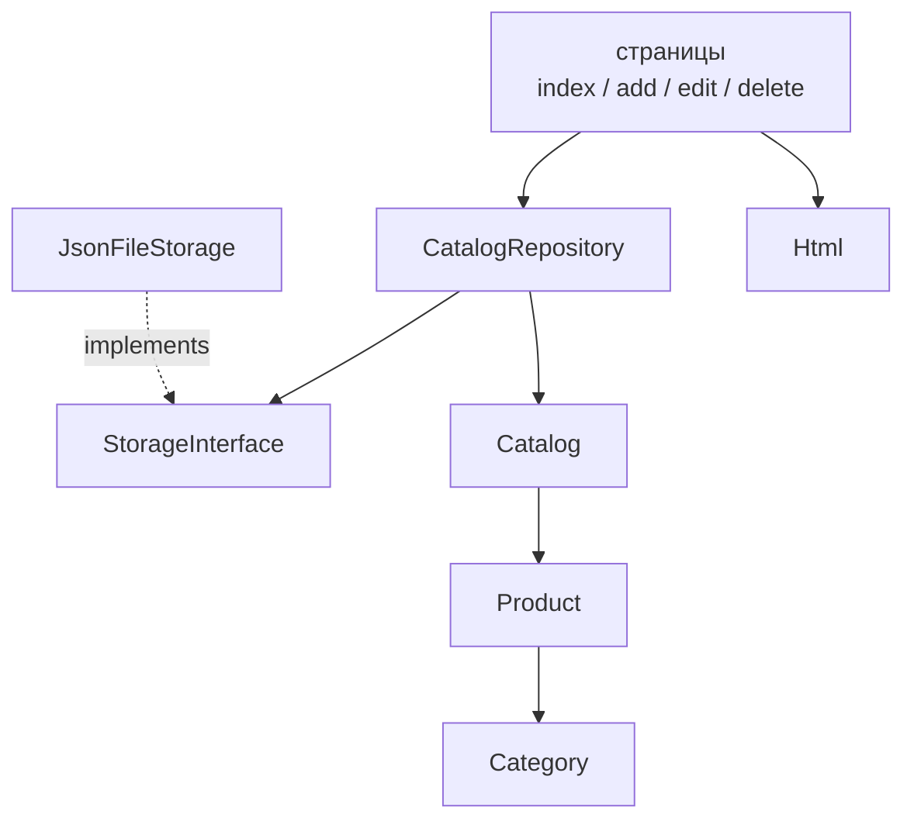

# Работа 6. ООП: каталог на классах

До этой работы весь каталог товаров был написан в **процедурном стиле**: данные
лежали в массивах, а действия — в отдельных функциях (`add_product`, `find_product`,
`validate_product` и так далее). Такой код работает, но у него есть слабое место:
функции не знают, какой именно массив им передали и какие ключи в нём обязаны быть.
Любая опечатка в ключе (`$product['titel']`) или не тот тип (`'цена-строка'`) выстрелит
только во время работы сайта.

В этой работе мы перепишем логику каталога на **объекты**. Это большой шаг, поэтому
конспект подробный: каждое новое слово объясняется простыми словами и сразу
показывается в коде. Никаких знаний ООП заранее не предполагается.

Материал разбит на три смысловые части:

- **Часть I. Основы** (разделы 1–5): что такое класс, объект, свойства, конструктор,
  инкапсуляция.
- **Часть II. Поведение и типы** (разделы 6–11): статические члены, перечисления,
  интерфейсы, наследование, исключения, магические методы.
- **Часть III. Организация кода** (разделы 12–13): пространства имён, Composer,
  сборка всего проекта вместе.

## Часть I. Основы

### 1. Зачем нужно ООП

#### 1.1. Как выглядит процедурный код и что в нём не так

Начнём с задачи: посчитать цену товара со скидкой. В процедурном стиле это выглядит
так:

```php
function price_with_discount(int $price, int $discount): float
{
    return round($price * (100 - $discount) / 100, 2);
}

$product = ['title' => 'Ноутбук', 'price' => 54990, 'discount' => 10];
echo price_with_discount($product['price'], $product['discount']);
```

Пока товар один и программа маленькая, всё хорошо. Но приложение растёт: появляются
добавление товара, поиск, сортировка, сохранение в файл, валидация формы. И тут
начинаются проблемы:

1. **Массив — «мешок без правил».** Функция `price_with_discount` ожидает два числа,
   но никто не мешает вызвать `price_with_discount('дорого', [])` — программа
   упадёт во время работы, а не при написании кода.
2. **Структура не проверяется.** Если в одном месте товар описывается ключом
   `'cost'`, а в другом `'price'`, PHP не подскажет ошибку — просто получится
   пустое значение.
3. **Данные и логика врозь.** Цена, скидка и правило расчёта — это одно понятие
   «товар», но живут они в разных местах: массив с данными отдельно, функция
   отдельно. Чем больше функций, тем труднее понять, что с чем связано.
4. **Всё связано со всем.** Функция `load_catalog()` возвращает массив, функции
   поиска принимают массив, функции валидации принимают другой массив, страницы
   склеивают это вручную. Изменение структуры товара затрагивает десяток файлов.

Ключевой недостаток: **программа не знает про предметную область ничего, кроме
«это массив с какими-то ключами»**.

#### 1.2. Та же задача через объект

```php
$product = new Product(1, 'Ноутбук', Category::Tech, 54990.0, 12, 10);
echo $product->priceWithDiscount();
```

Здесь товар — **единое целое**: в нём и данные (название, цена, скидка), и действия
над ними. Типы проверяются при создании. Читается как обычный язык: «у товара узнай
цену со скидкой».

#### 1.3. Аналогия «чертёж и изделие»

**Класс** — это чертёж. В чертеже описано, из чего состоит изделие и что оно умеет,
но самого изделия ещё нет. **Объект** — конкретное изделие, сделанное по чертежу.

- По чертежу «Дом» строят много разных домов (разной площади, цвета).
- По классу `Product` создают много разных товаров (разные названия, цены).
- Чертёж один; изделий — сколько угодно, и у каждого свои значения.

Ещё одна аналогия: класс — это форма для печенья, объект — само печенье. Форма
задаёт, какой будет фигура; каждое печенье при этом отдельное.

#### 1.4. Три кита ООП

- **Инкапсуляция** — объект прячет свои данные и сам следит, чтобы они оставались
  верными. Снаружи нельзя безнаказанно сломать товар.
- **Наследование** — один класс может взять поведение другого и дополнить его.
- **Полиморфизм** — разные классы можно использовать через общий «договор»
  (интерфейс), и код не будет знать, какой именно класс ему достался.

Порядок изучения у нас будет такой: сначала класс и объект, потом инкапсуляция,
затем перечисления и интерфейсы, и в конце — наследование и исключения.

#### 1.5. Когда ООП помогает, а когда нет

ООП — не самоцель. Небольшой скрипт из десяти строк выиграет от процедурного стиля:
меньше слов — больше ясности. ООП стоит применять, когда:

- у одного понятия есть и данные, и правила (товар, заказ, корзина);
- понятий много и их нужно описывать как типы;
- важен повторяемый «договор» между частями программы (хранилище, которое легко
  заменить);
- проект будет расти, и хочется менять одну часть, не ломая другие.

В нашем каталоге всё это есть, поэтому переход на ООП оправдан. Важно помнить:
инструмент должен упрощать, а не усложнять ради самого себя.

#### 1.6. Итог раздела

- Массив не описывает тип: сколько полей, какие ключи, какие типы.
- Класс описывает и данные, и поведение, и правила.
- Объект — конкретный экземпляр класса со своими значениями.
- ООП помогает, когда понятий много и между ними нужно чёткое разделение.

### 2. Класс и объект

#### 2.1. Объявление класса

Класс объявляется словом `class`, имя принято писать с большой буквы. Внутри класса
живут **свойства** (переменные) и **методы** (функции). Всё вместе называют
**членами класса**.

```php
class Product
{
    // свойства: у каждого объекта свои значения
    public int $id;
    public string $title;
    public float $price;

    // метод: действие над объектом
    public function priceWithDiscount(): float
    {
        return $this->price;
    }
}
```

Разберём по частям:

- `public` — **модификатор доступа**: «видно снаружи класса» (подробно в разделе 5);
- `int $id` — **типизированное свойство**: только целое число;
- `function priceWithDiscount(): float` — метод, возвращающий дробное число;
- `$this` — ссылка на **тот самый объект**, у которого вызван метод.

#### 2.2. Что такое «состояние» и «поведение»

У объекта есть две стороны:

- **состояние** — значения его свойств: `id = 1`, `title = 'Ноутбук'`, `price = 54990`;
- **поведение** — методы: что объект умеет делать (`priceWithDiscount`, `stockLabel`).

В хорошем классе данные и поведение связаны: поведение работает именно с состоянием
этого объекта, а не с чем-то посторонним.

#### 2.3. Создание объекта: слово `new`

Объект создаётся словом `new`. Класс — это описание, `new` — «сделай изделие по
чертежу».

```php
$product = new Product();   // создали объект
$product->id = 1;           // записали свойство
$product->title = 'Ноутбук';
$product->price = 54990.0;

echo $product->title;               // Ноутбук
echo $product->priceWithDiscount(); // 54990.0
```

- `new Product()` вызывает создание объекта и возвращает его;
- результат сохраняют в переменную: `$product`;
- `->` — «оператор объекта»: `$product->id` означает «свойство id этого объекта».

#### 2.4. Обращение к методам и свойствам: оператор `->`

```php
$product->title;                 // свойство
$product->priceWithDiscount();   // метод (со скобками)
```

Скобки обязательны: без них PHP решит, что вы обращаетесь к свойству. Если метод
ждёт аргументы, их передают в скобках: `$product->setPrice(59990)`.

Внутри класса к своим членам обращаются через `$this->`:

```php
public function priceWithDiscount(): float
{
    // $this->price — цена ЭТОГО объекта
    return round($this->price * (100 - $this->discount) / 100, 2);
}
```

#### 2.5. Несколько объектов независимы

По одному классу можно создать сколько угодно объектов, и у каждого свои значения:

```php
$notebook = new Product();
$notebook->title = 'Ноутбук';
$notebook->price = 54990.0;

$mouse = new Product();
$mouse->title = 'Мышь';
$mouse->price = 1990.0;

echo $notebook->title; // Ноутбук — не изменилось
echo $mouse->title;    // Мышь
```

Это принципиально: объекты не делят состояние между собой. Если нужно общее значение
для всех — это делается через `static` (раздел 6).

#### 2.6. Что печатает `var_dump` для объекта

`var_dump` показывает класс, свойства и даже private-свойства (для отладки):

```php
var_dump($notebook);
// object(Product)#1 (3) {
//   ["id"]=> int(1)
//   ["title"]=> string(14) "Ноутбук"
//   ["price"]=> float(54990)
// }
```

`print_r` и `var_export` тоже умеют показывать объекты — удобно при отладке.

#### 2.7. `instanceof` — проверка класса

Иногда нужно понять, какого типа объект:

```php
if ($product instanceof Product) {
    echo 'Это товар';
}
```

`instanceof` проверяет не только сам класс, но и его родителей, и реализованные
интерфейсы (пригодится дальше).

#### 2.8. Сравнение объектов: `==` и `===`

```php
$a = new Product();
$a->id = 1;
$a->title = 'Ноутбук';

$b = new Product();
$b->id = 1;
$b->title = 'Ноутбук';

$a == $b;    // true  — объекты «похожи»: те же класс и значения свойств
$a === $b;   // false — это РАЗНЫЕ объекты в памяти
```

- `==` сравнивает значения свойств;
- `===` сравнивает **идентичность**: один это объект или два разных.

Даже если значения совпадают, два объекта из двух `new` — разные. Для объектов это
важное отличие от строк и чисел.

#### 2.9. Объекты передаются «по ссылке»

Переменная хранит не сам объект, а ссылку на него. Поэтому, передав объект в
функцию, изменения будут видны снаружи:

```php
function rename(Product $product): void
{
    $product->title = 'Переименовано';
}

$notebook = new Product();
rename($notebook);
echo $notebook->title;   // Переименовано
```

Это удобно, но требует аккуратности: объект может измениться «где-то в глубине».
Именно поэтому часто делают объекты **неизменяемыми** (`readonly`, раздел 5).

#### 2.10. Типичные ошибки новичка

- забыли `new`: `$p = Product();` — так нельзя, нужно `$p = new Product();`;
- поставили `$` у имени свойства после `->`: правильно `$p->title`, а **не** `$p->$title`;
- забыли скобки у метода: `$p->priceWithDiscount` вернёт не результат, а ошибку;
- используют `$this` вне метода — снаружи класса его нет;
- надеются, что `==` и `===` для объектов означают одно и то же — это не так.

#### 2.11. Итог раздела

- Класс — описание, объект — конкретный экземпляр.
- `new` создаёт объект, `->` обращается к его членам, `$this` — «этот объект».
- Объекты независимы, сравниваются по `==` (значения) и `===` (идентичность),
  передаются по ссылке.

### 3. Свойства: типы и значения по умолчанию

#### 3.1. Зачем указывать тип

PHP — язык с типами, и в классах их удобно использовать. Тип сообщает PHP, что
допустимо в свойстве, и защищает от случайных ошибок.

```php
class Product
{
    public int $id;                  // только целое
    public string $title = '';       // строка, по умолчанию пустая
    public float $price = 0.0;       // дробное
    public int $stock = 0;           // целое, 0 — допустимо
    public bool $available = false;  // логическое
}
```

Если тип указан, запись другого типа вызовет ошибку:

```php
$p = new Product();
$p->id = 'один';   // TypeError: cannot assign string to property of type int
```

#### 3.2. Значения по умолчанию

Свойство может иметь начальное значение. Оно подставляется, пока вы не запишете
своё:

```php
public int $stock = 0;
public string $title = '';
```

Если значения по умолчанию нет, свойство при создании объекта считается
**неинициализированным**. Обращение к нему до записи — ошибка:

```php
class Product
{
    public int $id;   // без значения по умолчанию
}

$p = new Product();
echo $p->id;          // Error: must not be accessed before initialization
```

Именно поэтому обычно используют конструктор (раздел 4), который сразу задаёт
значения.

#### 3.3. Nullable-типы: `?Type`

Иногда значение может отсутствовать. Тогда перед типом ставят `?` — это означает
«значение типа или `null`»:

```php
public ?string $description = null;   // строка ИЛИ null
public ?Category $category = null;
```

#### 3.4. Объединённые (union) типы

Можно разрешить несколько типов через `|`:

```php
public int|string $code;      // либо число, либо строка
public int|float $amount = 0; // целое или дробное
```

Так же пишутся типы параметров и возвращаемых значений:

```php
public function find(int|string $id): ?Product
{
    // ...
}
```

#### 3.5. Специальные типы `mixed` и `void`

- `mixed` — «любое значение» (используйте редко, он теряет проверку типов);
- `void` — «метод ничего не возвращает» (для возвращаемого типа, не для свойств).

```php
public function dump(mixed $value): void
{
    var_dump($value);   // ничего не возвращаем
}
```

#### 3.6. Статические свойства (кратко)

Свойство может принадлежать не объекту, а всему классу. Тогда перед именем ставят
`static`, а обращаются через `::`:

```php
class Counter
{
    public static int $created = 0;

    public function __construct()
    {
        self::$created++;   // общий счётчик для всех объектов
    }
}

new Counter();
new Counter();
echo Counter::$created;     // 2
```

Подробно про `static` — в разделе 6.

#### 3.7. Типичные ошибки новичка

- путают объявление свойства (`public int $id;`) с обычной переменной (`$id = 0;`) —
  это разные вещи;
- записывают строку в `int`-свойство и удивляются ошибке типа — тип работает;
- забывают про неинициализированное свойство и получают ошибку при чтении;
- вместо `?Type` пытаются «разрешить null» как-то иначе — `?` и есть правильный
  способ.

#### 3.8. Итог раздела

- У свойства есть тип и, возможно, значение по умолчанию.
- `?Type` разрешает `null`, `A|B` — несколько типов, `mixed` — любой, `void` —
  «ничего не вернуть».
- Типы ловят ошибки на раннем этапе, а не в момент показа страницы пользователю.

### 4. Конструктор

#### 4.1. Проблема постепенного заполнения

Когда объект создаётся поэтапно (`new`, потом присвоили пять свойств), легко забыть
одно из них и получить «полупустой» товар:

```php
$product = new Product();
$product->id = 1;
$product->title = 'Ноутбук';
// забыли price — и объект уже нельзя считать полноценным
```

**Конструктор** решает эту проблему: это метод `__construct`, который PHP вызывает
автоматически в момент `new`. В него передают все обязательные данные сразу.

#### 4.2. Обычный конструктор

```php
class Product
{
    public int $id;
    public string $title;
    public float $price;

    public function __construct(int $id, string $title, float $price)
    {
        $this->id = $id;
        $this->title = $title;
        $this->price = $price;
    }
}

// Теперь объект нельзя создать «пустым» — нужно сразу передать данные:
$product = new Product(1, 'Ноутбук', 54990.0);
```

Аргументы, переданные в `new Product(...)`, попадают в параметры `__construct`.
Слева в методе — параметры (`$id`), справа — свойства (`$this->id`). Это разные
вещи, хотя имена совпадают. `$this->id = $id;` означает «свойству объекта присвоить
значение параметра».

#### 4.3. Сокращённая запись: property promotion

Раз объявление свойства и его присваивание в конструкторе почти всегда совпадают,
в PHP 8 добавили сокращение: пишем модификатор и тип прямо в параметрах
конструктора, а тело оставляем пустым.

```php
class Product
{
    public function __construct(
        public int $id,
        public string $title,
        public float $price,
    ) {
    }
}
```

Этот код полностью эквивалентен «длинной» записи выше. Такой приём называется
**property promotion** («продвижение свойств»). Разберём, что происходит «под
капотом»:

1. PHP видит `public int $id` в параметрах и **сам объявляет** свойство `$id`;
2. затем **сам присваивает** ему переданное значение;
3. тело конструктора при этом остаётся пустым (но может содержать проверки).

Запятая после последнего параметра разрешена — это удобно при добавлении новых строк.
Наш настоящий класс `Product` использует именно этот стиль.

#### 4.4. Значения по умолчанию в конструкторе

Параметр может иметь значение по умолчанию — тогда аргумент необязателен:

```php
class Product
{
    public function __construct(
        public int $id,
        public string $title,
        public float $price = 0.0,
        public int $discount = 0,
    ) {
    }
}

new Product(1, 'Ноутбук');              // discount = 0
new Product(2, 'Мышь', 1990.0, 10);     // discount = 10
```

Необязательные параметры должны идти **после** обязательных.

#### 4.5. Именованные аргументы

Аргументы можно передавать по имени, а не по порядку. Это повышает читаемость:

```php
$product = new Product(
    id: 3,
    title: 'Наушники',
    price: 3990.0,
    discount: 20,
);
```

Смешивать можно: сначала позиционные, потом именованные. Именованные удобно
пропускать необязательные в середине списка.

#### 4.6. Проверки в конструкторе (инварианты)

Конструктор — лучшее место для проверок: объект не должен родиться «неправильным».

```php
final class Product
{
    public function __construct(
        public readonly int $id,
        public readonly string $title,
        public readonly float $price,
    ) {
        if ($price < 0) {
            throw new InvalidArgumentException('Цена не может быть отрицательной');
        }
    }
}

new Product(1, 'Ноутбук', -5);   // исключение — товар не создан
```

Такие правила называют **инвариантами**: условия, при которых объект имеет право
существовать. Нарушение инварианта — ошибка программиста, поэтому выбрасывают
исключение (`throw`, раздел 10).

#### 4.7. `new` как выражение

`new` возвращает объект, поэтому его можно использовать прямо в вызове:

```php
$labels = array_map(
    fn (Product $product): string => $product->title,
    [new Product(1, 'A', 1.0), new Product(2, 'B', 2.0)]
);
```

#### 4.8. Типичные ошибки новичка

- вызвать конструктор как обычный метод (`$p->__construct(...)`) — не нужно, он
  вызывается сам при `new`;
- забыть передать обязательный аргумент: `new Product(1, 'Ноутбук')` → ошибка
  «слишком мало аргументов»;
- при promotion написать `$this->public int $id` — синтаксическая ошибка;
- поставить необязательный параметр перед обязательным — ошибка.

#### 4.9. Итог раздела

- Конструктор гарантирует, что объект сразу получает нужные данные.
- Property promotion и именованные аргументы делают код короче и понятнее.
- Проверки в конструкторе защищают инварианты объекта.

### 5. Инкапсуляция и readonly

#### 5.1. Что такое инкапсуляция

**Инкапсуляция** — это когда объект прячет внутренние данные и не даёт сломать себя
снаружи. Пользователь объекта видит только то, что мы разрешили, и не может
подсунуть недопустимое значение в обход правил.

Управляют доступом три слова:

| Слово       | Кто видит свойство или метод                       |
|-------------|----------------------------------------------------|
| `public`    | все: и внутри класса, и снаружи                    |
| `protected` | сам класс и его наследники (см. раздел 9)          |
| `private`   | только сам класс, снаружи недоступно               |

#### 5.2. Почему открытые данные опасны

Представьте, что цена товара открыта. Тогда снаружи можно написать:

```php
$product->price = -100;   // бессмысленный товар
```

Если же свойство `private`, снаружи к нему не подобраться:

```php
class Product
{
    private float $price;

    public function __construct(float $price)
    {
        $this->price = $price;
    }
}

$p = new Product(100.0);
$p->price = -100;   // Error: Cannot access private property
```

Так класс защищает свои правила.

#### 5.3. Геттеры: контролируемое чтение

Чтобы дать прочитать значение, добавляют метод-**геттер**:

```php
class Product
{
    private float $price;

    public function __construct(float $price)
    {
        if ($price < 0) {
            throw new InvalidArgumentException('Цена не может быть отрицательной');
        }
        $this->price = $price;
    }

    public function price(): float
    {
        return $this->price;
    }
}

$p = new Product(100.0);
echo $p->price();   // 100.0
```

Читать можно, изменить напрямую — нельзя.

#### 5.4. Управляемое изменение через методы

Если менять значение всё-таки нужно, делают метод, который проверяет правило:

```php
public function applyDiscount(float $discount): void
{
    if ($discount < 0 || $discount > 100) {
        throw new InvalidArgumentException('Скидка должна быть от 0 до 100');
    }
    $this->discount = $discount;
}
```

Снаружи нельзя поставить «скидку 150» — метод не даст.

#### 5.5. `readonly`: неизменяемые объекты

Часто объект вообще не нужно менять после создания. Тогда свойства помечают
`readonly` — «только для чтения»:

```php
final class Product
{
    public function __construct(
        public readonly int $id,
        public readonly string $title,
        public readonly float $price,
    ) {
        if ($price < 0) {
            throw new InvalidArgumentException('Цена не может быть отрицательной');
        }
    }
}
```

После создания изменить значение нельзя:

```php
$p = new Product(1, 'Ноутбук', 54990.0);
$p->price = 100;   // Error: Cannot modify readonly property
```

`readonly`-свойство задаётся ровно один раз — в конструкторе. Такой объект называют
**неизменяемым**. Чтобы «поменять» товар, создают новый объект с нужными значениями.

Такой подход очень удобен: если объект никто не может изменить, то, передавая его
в разные функции, вы уверены, что он останется прежним.

#### 5.6. `final` — от класса нельзя наследоваться

Слово `final` перед `class` запрещает наследование. Это уместно, когда класс
задуман как законченный:

```php
final class Product { /* ... */ }

// class DiscountedProduct extends Product {}  // Error: cannot extend final class
```

#### 5.7. Приватный метод-помощник

Приватными бывают не только свойства, но и методы — вспомогательные, не нужные
снаружи:

```php
final class Product
{
    public function __construct(
        public readonly float $price,
        public readonly int $discount,
    ) {
    }

    public function priceWithDiscount(): float
    {
        return $this->apply($this->price, $this->discount);
    }

    private function apply(float $price, int $discount): float
    {
        return round($price * (100 - $discount) / 100, 2);
    }
}
```

Снаружи `apply()` не виден: это деталь реализации. Такой подход, когда наружу
выставлено только необходимое, называют «узким интерфейсом» класса.

#### 5.8. Типичные ошибки новичка

- пытаться изменить `readonly`-свойство после создания объекта;
- обращаться снаружи к `private`-свойству → «Cannot access private property»;
- делать все свойства `public` «чтобы проще» — тогда класс теряет защиту;
- забывать, что `final`-класс нельзя наследовать.

#### 5.9. Итог раздела

- Инкапсуляция прячет данные и защищает инварианты.
- Геттеры и методы изменения дают контролируемый доступ.
- `readonly` делает объект неизменяемым, `final` запрещает наследование.

## Часть II. Поведение и типы

### 6. `static`, константы класса и `::` против `->`

#### 6.1. Что значит «принадлежит классу»

Обычный метод или свойство принадлежит **объекту**: у каждого товара своя цена.
Но иногда значение относится ко **всему классу** сразу, независимо от объекта.
Например, безопасное экранирование текста — общее правило, его не нужно привязывать
к конкретному товару. Такие члены называют **статическими** и помечают словом
`static`.

#### 6.2. Статический метод

```php
class Html
{
    public static function e(string $value): string
    {
        return htmlspecialchars($value, ENT_QUOTES, 'UTF-8');
    }
}

echo Html::e('<b>привет</b>'); // &lt;b&gt;привет&lt;/b&gt;
```

Такой метод вызывают через `::` (двойное двоеточие), не создавая объект:

```php
Html::e($text);
```

Внутри статического метода **нет** `$this` — объекта-то не существует. Если нужно
обратиться к другой статике того же класса, используют `self::`:

```php
class Html
{
    public const ENCODING = 'UTF-8';

    public static function e(string $value): string
    {
        return htmlspecialchars($value, ENT_QUOTES, self::ENCODING);
    }
}
```

#### 6.3. Константы класса

Константа объявляется словом `const` внутри класса. Её значение неизменно и
относится к классу:

```php
class Config
{
    public const PER_PAGE = 5;

    public static function perPage(): int
    {
        return self::PER_PAGE;
    }
}

echo Config::PER_PAGE;    // 5
echo Config::perPage();   // 5
```

В константах допустимы простые выражения:

```php
public const PAGE_SIZE = 10;
public const HALF_PAGE = self::PAGE_SIZE / 2;
```

#### 6.4. Статические свойства

Статическое свойство — общее для всех объектов класса:

```php
class Counter
{
    public static int $created = 0;

    public function __construct()
    {
        self::$created++;
    }
}

new Counter();
new Counter();
echo Counter::$created;   // 2
```

Обратите внимание на `self::$created`: у статических свойств тоже есть знак `$`.

#### 6.5. Статическая фабрика

Статический метод удобно использовать как «фабрику» — способ создать объект другим
путём:

```php
final class Product
{
    public function __construct(
        public readonly int $id,
        public readonly string $title,
        public readonly float $price,
    ) {
    }

    // фабрика: собрать товар из массива (например, из JSON)
    public static function fromArray(array $row): self
    {
        return new self(
            id: (int) ($row['id'] ?? 0),
            title: (string) ($row['title'] ?? ''),
            price: (float) ($row['price'] ?? 0),
        );
    }
}
```

`new self(...)` означает «создать объект того же класса, в котором мы находимся».
Такой метод вызывают `Product::fromArray($row)`.

#### 6.6. Аннотация `@return self`

В комментариях-аннотациях пишут предполагаемый тип. Это помогает редактору:

```php
/** @return Product[] */
public function all(): array
{
    return $this->products;
}
```

Аннотация не проверяется PHP, но очень помогает при чтении кода и автодополнении.

#### 6.7. `::` против `->`: шпаргалка

| Запись              | К чему обращаемся        | Пример                     |
|---------------------|--------------------------|----------------------------|
| `$obj->method()`    | метод объекта            | `$product->price()`        |
| `$obj->prop`        | свойство объекта         | `$product->title`          |
| `Class::method()`   | статический метод        | `Html::e($x)`              |
| `Class::CONST`      | константа класса         | `Config::PER_PAGE`         |
| `self::method()`    | статика внутри класса    | `self::perPage()`          |
| `self::$prop`       | статическое свойство     | `self::$created`           |

#### 6.8. Типичные ошибки новичка

- `$product::priceWithDiscount()` — так к обычному методу не обращаются;
- `Html->e(...)` — статический метод вызывается через `::`;
- использовать `$this` в статическом методе — там нет объекта;
- забыть `$` у статического свойства: нужно `self::$created`, а не `self::created`.

#### 6.9. Итог раздела

- `static` — «принадлежит классу, а не объекту».
- Статические методы и константы вызывают через `::`.
- Статические фабрики (`fromArray`) удобны для создания объектов из внешних данных.

### 7. Перечисления `enum`

#### 7.1. Проблема строковых категорий

В процедурном коде категория была строкой: `'Техника'`. Строку легко опечатать
(`'технка'`, `'Технка'`, лишний пробел), и PHP об этом не предупредит. Ошибку
заметит только пользователь, когда фильтр «почему-то» ничего не найдёт.

**Перечисление** (`enum`) — это тип с заранее известным списком допустимых значений.
Компилятор не даст написать несуществующий вариант.

#### 7.2. Объявление enum

```php
enum Category: string
{
    case Tech = 'Техника';
    case Games = 'Игры';
    case Accessories = 'Аксессуары';
}
```

- каждый вариант — это `case`;
- `: string` означает, что у каждого варианта есть строковое значение (`->value`);
- внутри один и тот же вариант — это один и тот же объект, поэтому сравнение `===`
  работает.

#### 7.3. Методы внутри enum

Enum может иметь методы — как обычный класс:

```php
enum Category: string
{
    case Tech = 'Техника';
    case Games = 'Игры';
    case Accessories = 'Аксессуары';

    public function label(): string
    {
        return $this->value;          // человекочитаемое название
    }

    public static function labels(): array
    {
        return array_map(
            fn (self $category): string => $category->value,
            self::cases()
        );
    }
}
```

#### 7.4. Работа со значениями

```php
Category::Tech->value;              // 'Техника'  — строковое значение
Category::Games->label();           // 'Игры'     — вызвать метод у варианта
Category::from('Аксессуары');       // Category::Accessories — строка -> enum
Category::tryFrom('Ерунда');        // null        — если такого значения нет
Category::cases();                  // массив всех вариантов
Category::labels();                 // ['Техника', 'Игры', 'Аксессуары']
```

- `from()` бросает ошибку, если значения нет в списке;
- `tryFrom()` в этом случае возвращает `null` — им удобно проверять данные из формы
  или файла.

#### 7.5. enum и `match`

`match` отлично сочетается с перечислениями:

```php
public function shortName(): string
{
    return match ($this) {
        self::Tech => 'Тех',
        self::Games => 'Игры',
        self::Accessories => 'Акс',
    };
}
```

`match` без `default` требует, чтобы были перечислены **все** варианты — хорошая
защита: если добавите новую категорию, PHP напомнит об этом.

#### 7.6. Перебор вариантов

Часто нужно построить список для формы `<select>`:

```php
$options = '';
foreach (Category::cases() as $category) {
    $options .= '<option value="' . $category->value . '">'
        . $category->label() . '</option>';
}
```

#### 7.7. enum как тип

Enum можно указывать в типах свойств, параметров и возвращаемых значений:

```php
final class Product
{
    public function __construct(
        public readonly string $title,
        public readonly Category $category,   // только Category, не строка
    ) {
    }
}
```

Теперь передать в категорию произвольную строку невозможно — только один из
вариантов.

#### 7.8. Почему это лучше строки

- опечатка невозможна — компилятор подсказывает варианты;
- сравнение `===` надёжно;
- в `match` проверка полноты;
- редактор подсказывает, какие категории существуют.

#### 7.9. Типичные ошибки новичка

- сравнить enum со строкой: `$category === 'Техника'` — не сработает, нужно
  `$category === Category::Tech` или `$category->value === 'Техника'`;
- использовать `from()` на «сырых» данных формы без обработки ошибки — лучше
  `tryFrom()` и проверка на `null`;
- забыть `: string`, если нужен `->value` — без него это «чистый» enum без значений.

#### 7.10. Итог раздела

- `enum` — строгий список допустимых значений.
- `from()`/`tryFrom()` переводят строку в вариант, `->value` и методы — обратно.
- Enum делает категорию типом, а не строкой.

### 8. Интерфейсы и полиморфизм

#### 8.1. Что такое интерфейс

**Интерфейс** — это «договор» или «список обязанностей». В нём перечислены методы
без реализации, а класс, который его подписывает словом `implements`, обязан их
написать.

**Аналогия.** Розетка — это интерфейс: у неё фиксированная форма. Любой прибор с
подходящей вилкой можно включить, и розетке не важно, чайник это, фен или зарядка.
Интерфейс задаёт «форму вилки», а конкретные классы — это приборы.

#### 8.2. Объявление интерфейса

```php
interface StorageInterface
{
    /** @return array<int, array<string, mixed>> */
    public function load(): array;

    /** @param array<int, array<string, mixed>> $rows */
    public function save(array $rows): void;
}
```

Интерфейс описывает: «любой, кто хранит каталог, умеет загрузить массив и сохранить
массив». Как именно — неважно.

#### 8.3. Реализация интерфейса

```php
final class JsonFileStorage implements StorageInterface
{
    public function __construct(private readonly string $file)
    {
    }

    public function load(): array
    {
        // ... читает файл, чинит испорченный, возвращает массив
    }

    public function save(array $rows): void
    {
        // ... записывает массив в JSON-файл
    }
}
```

Класс обязан реализовать **все** методы интерфейса с совпадающими сигнатурами.

#### 8.4. Что такое полиморфизм

Теперь любой код может работать не с конкретным `JsonFileStorage`, а с
`StorageInterface`. Это и есть **полиморфизм**: одна и та же логика работает с
разными реализациями.

```php
function backup(StorageInterface $storage): void
{
    $rows = $storage->load();   // работает с ЛЮБЫМ хранилищем
    // ...
}
```

Сегодня мы передадим файловое хранилище, завтра — работающее с базой данных. Функция
`backup` менять не придётся.

#### 8.5. Внедрение зависимости (DI)

Передача готового хранилища в другой класс называется **внедрением зависимости**
(англ. dependency injection, DI):

```php
$storage = new JsonFileStorage(__DIR__ . '/data/catalog.json');
$repository = new CatalogRepository($storage);   // зависимость передана снаружи
```

`CatalogRepository` не создаёт хранилище сам, а принимает его готовым. Это гибко:

- легко заменить хранилище, не трогая репозиторий;
- в тестах можно подсунуть хранилище, работающее во временном файле, — и не портить
  настоящие данные.

Если бы репозиторий создавал хранилище внутри себя (`new JsonFileStorage(...)` в
конструкторе), заменить его было бы нельзя. Поэтому зависимости «принимают», а не
«создают».

#### 8.6. Типизация по интерфейсу

Везде, где возможно, указывайте в типах интерфейс, а не конкретный класс:

```php
public function __construct(private readonly StorageInterface $storage)
{
}
```

Так класс становится независимым от способа хранения.

#### 8.7. Интерфейс как замена наследованию

Интерфейс не даёт реализации — только обязывает. Это позволяет одному классу
выполнять несколько «договоров»:

```php
final class Catalog implements Countable, IteratorAggregate
{
    // count() из Countable и getIterator() из IteratorAggregate
}
```

Класс может реализовать сколько угодно интерфейсов, и это не создаёт сложных
цепочек наследования.

#### 8.8. Типичные ошибки новичка

- забыть реализовать метод из интерфейса → ошибка «must implement»;
- изменить сигнатуру метода из интерфейса (лишний аргумент, другой тип) — нельзя,
  договор должен соблюдаться точно;
- создавать зависимость внутри класса вместо передачи снаружи — тогда смысл DI
  теряется;
- путать `extends` (наследование класса) и `implements` (подписка на интерфейс).

#### 8.9. Итог раздела

- Интерфейс — договор о том, что класс умеет.
- Полиморфизм позволяет писать код, независимый от конкретной реализации.
- DI — способ передавать зависимости снаружи, делая код гибким и тестируемым.

### 9. Наследование и `abstract`

#### 9.1. Что такое наследование

**Наследование** позволяет одному классу взять поведение другого и дополнить его.
Пишется словом `extends`. Класс-родитель ещё называют базовым или суперклассом,
класс-потомок — наследником.

**Аналогия.** Есть общий класс «Транспорт» с методом «двигаться». «Автомобиль» и
«Велосипед» наследуют его и добавляют свои детали. Общее остаётся в родителе, разное
— в наследниках.

#### 9.2. Свой пример: своё исключение

```php
class ProductNotFoundException extends RuntimeException
{
    public function __construct(public readonly int $productId)
    {
        parent::__construct("Товар #{$productId} не найден");
    }
}
```

Здесь `ProductNotFoundException` наследует от встроенного класса `RuntimeException`:

- он получает всё его поведение (умеет быть «выброшенным», хранить сообщение);
- добавляет своё — свойство `productId`;
- `parent::__construct(...)` вызывает конструктор родителя и передаёт ему текст.

`parent::` — обращение к родительскому классу.

#### 9.3. Переопределение методов

Наследник может заменить метод родителя своей реализацией:

```php
class Animal
{
    public function sound(): string
    {
        return '...';
    }
}

class Dog extends Animal
{
    public function sound(): string
    {
        return 'Гав';
    }
}

echo (new Dog())->sound();   // Гав
```

#### 9.4. `protected` — доступ для наследников

`protected`-член виден и внутри класса, и в наследниках, но не снаружи:

```php
class Animal
{
    protected string $name = '';

    public function __construct(string $name)
    {
        $this->name = $name;
    }
}

class Dog extends Animal
{
    public function greeting(): string
    {
        return 'Привет, я ' . $this->name;   // доступ к protected
    }
}
```

#### 9.5. Абстрактные классы и методы

Иногда базовый класс сам по себе бессмысленен — его должны дополнять наследники.
Тогда используют `abstract`.

```php
abstract class Shape
{
    abstract public function area(): float;   // реализацию пишет наследник

    public function describe(): string
    {
        return 'Площадь: ' . $this->area();
    }
}

class Circle extends Shape
{
    public function __construct(private float $radius)
    {
    }

    public function area(): float
    {
        return round(M_PI * $this->radius ** 2, 2);
    }
}
```

- объект `abstract`-класса создать нельзя;
- `abstract`-метод не имеет тела — наследник обязан его реализовать.

#### 9.6. Интерфейс против абстрактного класса

| Вопрос                          | Интерфейс                  | Абстрактный класс          |
|---------------------------------|----------------------------|----------------------------|
| Можно реализовать несколько?    | да (`implements A, B`)     | нет (только один `extends`)|
| Есть ли общий код?              | нет                        | да                         |
| Есть ли свойства?               | нет                        | да                         |
| Когда использовать?             | «что умеет»                | «чем является»             |

Правило: если нужен только договор — интерфейс; если нужен общий код с обязательным
дополнением — абстрактный класс.

#### 9.7. `final` — остановить наследование

Иногда класс задуман как законченный, и наследовать его нежелательно:

```php
final class Product { /* ... */ }
```

Аналогично можно запретить переопределение отдельного метода:

```php
final public function id(): int
{
    return $this->id;
}
```

#### 9.8. Когда наследование не нужно

Наследование — мощный, но опасный инструмент. Глубокие цепочки классов трудно
понимать. Если класс просто **использует** другой, лучше применить композицию
(вложить объект), а не наследовать:

```php
// Плохо: «репозиторий ЯВЛЯЕТСЯ хранилищем» — сомнительно
class CatalogRepository extends JsonFileStorage {}

// Хорошо: «репозиторий ИСПОЛЬЗУЕТ хранилище»
class CatalogRepository
{
    public function __construct(private StorageInterface $storage) {}
}
```

В нашем проекте наследование применяется умеренно — в основном для своих исключений.

#### 9.9. Типичные ошибки новичка

- забыть `parent::__construct()` — тогда родитель не получит данные;
- перепутать `extends` и `implements`;
- пытаться создать объект `abstract`-класса напрямую;
- наследовать «на всякий случай» вместо композиции.

#### 9.10. Итог раздела

- Наследование расширяет класс, `parent::` обращается к родителю.
- `abstract` задаёт «заготовку», которую дополняют наследники.
- `final` запрещает наследование; композиция часто лучше наследования.

### 10. Исключения

#### 10.1. Что такое исключение

**Исключение** — это способ сообщить об ошибке, которую нельзя «переварить» на
месте. Исключение «бросают» словом `throw` и «ловят» конструкцией `try / catch`.

```php
try {
    $product = $repository->find(999);   // может бросить исключение
    echo $product->title;
} catch (ProductNotFoundException $e) {
    // сюда попадаем только если товар не найден
    http_response_code(404);
    echo $e->getMessage();               // «Товар #999 не найден»
}
```

- код в `try` выполняется, пока не произойдёт исключение;
- `catch` перехватывает исключение указанного типа; `$e` — сам объект исключения.

#### 10.2. `throw` и объект исключения

```php
if ($product === null) {
    throw new ProductNotFoundException($id);
}
```

После `throw` выполнение текущего метода прерывается, и исключение «всплывает»
вверх по вызовам до ближайшего подходящего `catch`. Если такого нет — PHP покажет
фатальную ошибку «Uncaught».

#### 10.3. Иерархия исключений

В PHP есть базовый интерфейс `Throwable`. От него происходят `Error` (ошибки
программиста) и `Exception`. У `Exception` много потомков:

```
Throwable
├── Error
│   └── TypeError, ValueError, ...
└── Exception
    ├── RuntimeException
    │   └── ProductNotFoundException
    ├── InvalidArgumentException
    │   └── (наш) InvalidArgumentException
    └── ...
```

Чем точнее класс исключения, тем понятнее, что случилось.

#### 10.4. Своё исключение

```php
class ProductNotFoundException extends RuntimeException
{
    public function __construct(public readonly int $productId)
    {
        parent::__construct("Товар #{$productId} не найден");
    }
}
```

Своё исключение удобно тем, что:

- у него говорящее имя;
- в него можно добавить данные (`productId`);
- его можно ловить отдельно от других ошибок.

#### 10.5. Полезные методы исключения

```php
try {
    $repository->find(999);
} catch (ProductNotFoundException $e) {
    echo $e->getMessage();   // текст сообщения
    echo $e->getCode();      // код (int), обычно 0
    echo $e->productId;      // наше дополнительное свойство
}
```

#### 10.6. Несколько `catch` и `finally`

Можно ловить разные типы по-разному, от точного к общему:

```php
try {
    $repository->find($id);
} catch (ProductNotFoundException $e) {
    http_response_code(404);
} catch (Throwable $e) {
    http_response_code(500);
    echo 'Что-то пошло не так';
}
```

Блок `finally` выполняется всегда — и при ошибке, и без неё:

```php
try {
    $storage->save($rows);
} catch (StorageException $e) {
    echo 'Ошибка записи';
} finally {
    echo 'Попытка записи завершена';
}
```

#### 10.7. Цепочка исключений (`previous`)

Когда одно исключение вызвано другим, причину можно сохранить:

```php
try {
    $json = json_encode($rows);
} catch (Throwable $e) {
    throw new StorageException('Не удалось сериализовать каталог', previous: $e);
}
```

Позже `$e->getPrevious()` вернёт исходную ошибку.

#### 10.8. Главное правило: массив или исключение

В этой работе есть важное правило, которое стоит запомнить:

- **ошибки пользователя** (пустое название, цена-текст, скидка 150) — это
  **ожидаемая** ситуация. Их собирают в **массив** `['title' => '...', 'price' => '...']`
  и показывают под полями формы. Пользователь может ошибиться в пяти полях сразу —
  массив удобно обойти и вывести все подсказки;
- **«невозможные» ситуации** (товара нет, файл не читается, нарушен инвариант) — это
  **исключения**. Их нельзя показать «под полем»; программа должна сменить ход
  выполнения: отдать 404 или остановиться с понятной ошибкой.

Поэтому в проекте:

- `ProductValidator::validate()` возвращает массив ошибок;
- репозиторий бросает `ProductNotFoundException`;
- хранилище бросает `StorageException` при сбое работы с файлом;
- конструктор `Product` бросает `InvalidArgumentException` при плохих данных.

#### 10.9. Типичные ошибки новичка

- обернуть в `try` весь код «на всякий случай» — так прячут настоящие баги;
- «проглотить» исключение пустым `catch {}` — ошибка исчезнет, а причина нет;
- использовать исключения для обычной валидации формы вместо массива;
- ловить `Exception` там, где можно поймать точный класс исключения.

#### 10.10. Итог раздела

- `throw` бросает исключение, `try/catch` ловит, `finally` выполняется всегда.
- Свои исключения делают ошибки говорящими и перехватываемыми точечно.
- Ошибки ввода — массив, «невозможные» ситуации — исключения.

### 11. Магические методы и встроенные интерфейсы

#### 11.1. Что такое магические методы

**Магические методы** — это методы с именами, начинающимися на два подчёркивания.
PHP вызывает их сам в особых ситуациях, а не по вашему прямому вызову. Два самых
полезных для нас:

- `__construct(...)` — при создании объекта (`new`);
- `__toString()` — когда объект требуется превратить в строку.

#### 11.2. `__toString`

`__toString` позволяет печатать объект как строку:

```php
public function __toString(): string
{
    return sprintf('#%d %s — %s', $this->id, $this->title, $this->category->value);
}
```

Теперь объект можно подставить в `echo` или в конкатенацию:

```php
$product = new Product(3, 'Наушники JBL Tune', Category::Accessories, 3990.0, 30, 20);
echo $product;              // #3 Наушники JBL Tune — Аксессуары
echo 'Товар: ' . $product;  // Товар: #3 Наушники JBL Tune — Аксессуары
```

Без `__toString` попытка превратить объект в строку — фатальная ошибка.

#### 11.3. Зачем встроенные интерфейсы

Мы хотим, чтобы с объектом `Catalog` можно было работать как с массивом: считать
через `count()` и перебирать через `foreach`. Для этого PHP предоставляет
**встроенные интерфейсы**:

- `Countable` — добавляет работу `count()`;
- `IteratorAggregate` — добавляет работу `foreach`.

#### 11.4. Реализация `Countable` и `IteratorAggregate`

```php
final class Catalog implements Countable, IteratorAggregate
{
    /** @var Product[] */
    private array $products = [];

    public function count(): int
    {
        return count($this->products);
    }

    public function getIterator(): Traversable
    {
        return new ArrayIterator($this->products);
    }
}

$catalog = new Catalog([$product]);
count($catalog);              // работает благодаря Countable
foreach ($catalog as $item) { // работает благодаря IteratorAggregate
    echo $item->title;
}
```

- `Countable` требует метод `count()` — что вернуть от `count($catalog)`;
- `IteratorAggregate` требует метод `getIterator()` — что перебирать в `foreach`.

Фактически мы «одеваем» объект в привычную для PHP одежду массива, оставляя внутри
свою структуру и свои методы.

#### 11.5. Почему это удобно

Вместо ручного `$catalog->all()` в цикле:

```php
foreach ($catalog->all() as $item) { ... }
```

можно писать коротко и естественно:

```php
foreach ($catalog as $item) { ... }
```

А `count($catalog)` читается лучше, чем `$catalog->countItems()`.

#### 11.6. Другие магические методы (обзорно)

- `__get`/`__set` — доступ к «виртуальным» свойствам;
- `__isset`/`__unset` — работа `isset()`/`unset()`;
- `__call` — вызов несуществующего метода;
- `__invoke` — вызов объекта как функции;
- `__clone` — настройка копирования.

В нашем проекте они не нужны, но полезно знать, что такие есть.

#### 11.7. Типичные ошибки новичка

- надеяться, что `echo $object` заработает без `__toString`;
- реализовать `Countable`, но забыть `count()` — ошибка «must implement»;
- возвращать из `getIterator()` массив вместо объекта-итератора — нужен
  `ArrayIterator` (или другой `Traversable`).

#### 11.8. Итог раздела

- Магические методы PHP вызывает сам; `__toString` печатает объект.
- Встроенные интерфейсы `Countable`/`IteratorAggregate` включают `count()` и
  `foreach` для объекта.

## Часть III. Организация кода

### 12. Пространства имён и автозагрузка через Composer

#### 12.1. Проблема: имена классов могут совпасть

Когда классов много, их короткие имена могут совпасть. В одном проекте может быть
свой `Validator`, в библиотеке — тоже `Validator`, и PHP не поймёт, какой вы имели
в виду. Решение — **пространства имён** (`namespace`): это «фамилии» для классов.

```php
namespace App;      // все классы ниже принадлежат пространству App

final class Product { /* ... */ }
```

Полное имя класса теперь — `App\Product`. Оно уникально, как «Иванов Иван» вместо
просто «Иван».

#### 12.2. Импорт через `use`

Чтобы не писать `App\Product` каждый раз, класс «импортируют»:

```php
use App\Product;
use App\CatalogRepository;

$product = new Product(...);        // PHP понимает: App\Product
$repo = new CatalogRepository(...); // PHP понимает: App\CatalogRepository
```

Можно давать псевдоним, если имена длинные или конфликтуют:

```php
use App\Product as ProductEntity;
```

#### 12.3. Проблема: подключать файлы вручную

Даже с пространствами имён PHP не знает, в каком **файле** лежит класс. Приходилось
бы писать:

```php
require 'src/Category.php';
require 'src/Product.php';
require 'src/ProductValidator.php';
// ... и ещё десять строк
```

Это неудобно и легко забыть строку. Решение — **автозагрузка**: PHP сам подключает
файл, когда встречает неизвестный класс.

#### 12.4. Composer: автозагрузка по правилу PSR-4

В современном PHP автозагрузку почти всегда доверяют **Composer** — менеджеру
зависимостей. Мы не будем писать автозагрузчик руками: Composer сгенерирует его за
нас. Достаточно описать правило «где искать классы» в файле `composer.json`:

```json
{
    "autoload": {
        "psr-4": {
            "App\\": "src/"
        }
    }
}
```

Читается так: «классы, чьё имя начинается с `App\`, лежат в папке `src/`».
Правило соответствия **имени класса и пути к файлу** называют **PSR-4**:

| Класс          | Файл             |
|----------------|------------------|
| `App\Product`  | `src/Product.php`|
| `App\Catalog`  | `src/Catalog.php`|
| `App\Category` | `src/Category.php`|

Обратите внимание: имя файла совпадает с именем класса. Это обязательное правило
PSR-4 — иначе автозагрузчик файл не найдёт.

#### 12.5. Установка: `composer install`

Рядом с `composer.json` выполняют одну команду:

```bash
composer install
```

Composer создаёт папку `vendor/` и генерирует в ней файл `vendor/autoload.php`.
Этот файл и есть готовый автозагрузчик. Его подключают **один раз** в начале
приложения:

```php
require __DIR__ . '/vendor/autoload.php';

// дальше можно смело писать:
$product = new App\Product(...);
```

После этого ни одного `require` для классов писать не нужно.

#### 12.6. Что такое `vendor/`

`vendor/` — папка со сторонними библиотеками и сгенерированным автозагрузчиком.
Правило: **её не редактируют руками и не коммитят в репозиторий**. Она полностью
воспроизводится командой `composer install`. Файл `composer.json` — это «описание»,
а `vendor/` — «результат». В репозиторий кладут описание, а результат каждый
разворачивает у себя.

Поэтому в проекте обычно добавляют `vendor/` в `.gitignore`.

#### 12.7. Автозагрузка после добавления классов

Самый приятный момент: при PSR-4-автозагрузке **новые классы подхватываются
автоматически**. Добавили `src/Order.php` с классом `App\Order` — и он сразу
доступен, перезапускать установку не нужно. Composer сопоставляет имя и путь на
лету.

Если же меняется само правило (например, добавили пространство `App\Admin\` →
`src/Admin/`), нужно перегенерировать автозагрузчик:

```bash
composer dump-autoload
```

#### 12.8. Что Composer делает «под капотом»

Composer не волшебник: сгенерированный им `vendor/autoload.php` внутри использует
тот самый механизм `spl_autoload_register`, о котором мы говорили. Просто писать
его руками больше не нужно — Composer делает это правильно и одинаково во всех
проектах. Так что понимание «автозагрузка = функция, которую PHP вызывает для
неизвестного класса» остаётся верным.

#### 12.9. Мини-версия «как это выглядело бы руками»

Полезно один раз увидеть, что происходит внутри. Вот упрощённый ручной
автозагрузчик для нашего правила PSR-4:

```php
spl_autoload_register(function (string $class): void {
    $prefix = 'App\\';
    if (!str_starts_with($class, $prefix)) {
        return;
    }
    $relative = substr($class, strlen($prefix));         // Product, Catalog, ...
    $file = __DIR__ . '/src/' . str_replace('\\', '/', $relative) . '.php';
    if (is_file($file)) {
        require $file;
    }
});
```

Именно это (в более развитом виде) Composer и генерирует. В задании мы этот код
писать не будем — используем готовый `vendor/autoload.php`.

#### 12.10. Типичные ошибки новичка

- забыли выполнить `composer install` — тогда нет `vendor/autoload.php`, и классы
  не находятся;
- файл назван не так, как класс (`product.php` вместо `Product.php`) — PSR-4 не
  найдёт;
- класс объявлен не в том namespace, что указан в `composer.json`;
- вручную правят файлы в `vendor/` — при следующем `composer install` изменения
  пропадут.

#### 12.11. Итог раздела

- Пространство имён делает имена классов уникальными, `use` сокращает запись.
- Composer по правилу PSR-4 генерирует автозагрузчик `vendor/autoload.php`.
- `composer install` создаёт `vendor/`, новые классы в `src/` подхватываются сами.
- `vendor/` не коммитят; правило задаётся в `composer.json`.

### 13. Собираем всё вместе

#### 13.1. Карта классов проекта

Наш проект `pr6` разделён на «слои». Чем чётче границы, тем проще менять код.

| Класс                  | За что отвечает                                        |
|------------------------|--------------------------------------------------------|
| `Category` (enum)      | список допустимых категорий и их названия              |
| `Product`              | один товар: данные + расчёты цены и наличия            |
| `ProductValidator`     | проверка данных формы, возвращает массив ошибок        |
| `Catalog`              | коллекция товаров: поиск, фильтр, сортировка, страницы |
| `StorageInterface`     | «договор» хранилища: `load()` и `save()`               |
| `JsonFileStorage`      | хранилище в JSON-файле с восстановлением               |
| `CatalogRepository`    | связывает `Catalog` и `StorageInterface`               |
| `Html`                 | безопасный вывод (`htmlspecialchars`)                  |
| `ProductNotFoundException` | исключение «товара с таким id нет»                 |
| `StorageException`     | исключение «ошибка работы с файлом»                    |
| `InvalidArgumentException` | исключение «нарушены правила класса»               |

#### 13.2. Схема связей

Сплошная стрелка — «использует», пунктирная — «реализует» (`implements`):



- страницы ничего не знают о файле — только о репозитории;
- репозиторий ничего не знает о конкретном хранилище — только об интерфейсе;
- `Catalog` работает только с объектами `Product`;
- `Product` знает про `Category` и умеет считать цену.

Такое разделение называют **слоями**. Меняя один слой, мы не трогаем остальные.

#### 13.3. Путь одного запроса

Полезно проследить, что происходит, когда пользователь открывает список товаров:

1. `index.php` подключает `vendor/autoload.php` и создаёт объекты;
2. вызывает `$repository->load()` — «дай каталог»;
3. репозиторий просит строки у `$storage->load()` (Composer уже нашёл классы);
4. `JsonFileStorage` читает `data/catalog.json`, при необходимости чинит его;
5. репозиторий превращает строки в объекты `Product` и собирает `Catalog`;
6. `index.php` вызывает у каталога `search()`, `filterByCategory()`, `sortByPrice()`,
   `paginate()`;
7. страница выводит товары, экранируя всё через `Html::e()`.

На каждом шаге участник занимается **только своим делом**.

#### 13.4. «Было → стало»

| Задача               | Было (pr5, процедурно)        | Стало (pr6, ООП)                  |
|----------------------|-------------------------------|-----------------------------------|
| Товар                | массив `$product['title']`    | объект `$product->title`          |
| Категория            | строка `'Техника'`            | enum `Category::Tech`             |
| Скидка               | `price_with_discount(...)`    | `$product->priceWithDiscount()`   |
| Наличие              | `stock_label(...)`            | `$product->stockLabel()`          |
| Список товаров       | массив массивов               | объект `Catalog` (`count`, `foreach`) |
| Хранилище            | функции `load_catalog/save_catalog` | класс `JsonFileStorage` + интерфейс |
| Валидация            | `validate_product()`          | `ProductValidator::validate()`    |
| Нет товара           | «функция вернула null»        | исключение `ProductNotFoundException` |
| Ошибка файла         | «вернула false»               | исключение `StorageException`     |
| Подключение классов  | `require` вручную             | Composer (`vendor/autoload.php`)  |

#### 13.5. Почему такая архитектура хороша

- **Понятность.** Каждый класс делает одно и понимает только своё.
- **Заменяемость.** Хранилище за интерфейсом: файл сегодня, база завтра.
- **Тестируемость.** `Product` и `Catalog` — чистые объекты, их можно проверять без
  браузера и без файлов.
- **Безопасность.** Вывод только через `Html::e()`, вход только через валидатор,
  инварианты — в конструкторе.

Теперь, когда понятны все отдельные части, можно переходить к заданию: в нём мы
по шагам соберём эти классы и снова получим работающий каталог — только на объектах.
