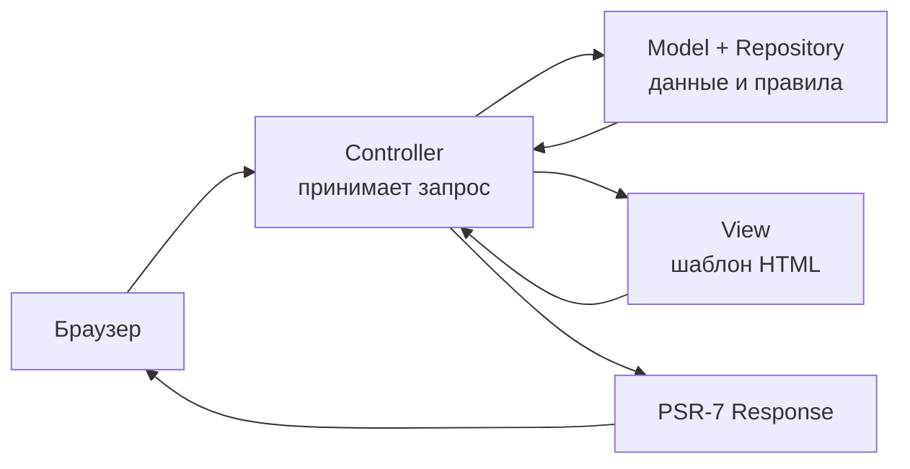
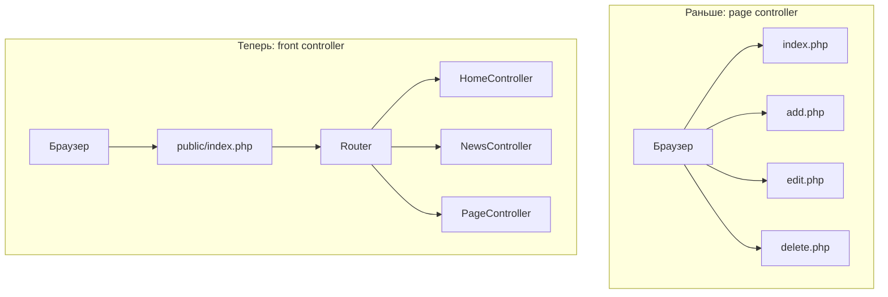
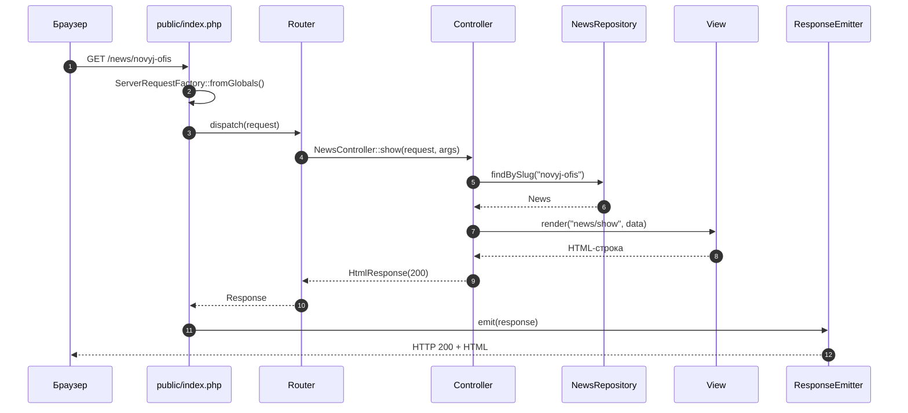
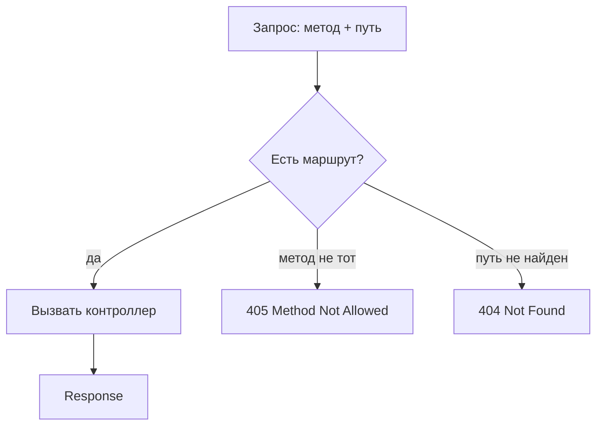
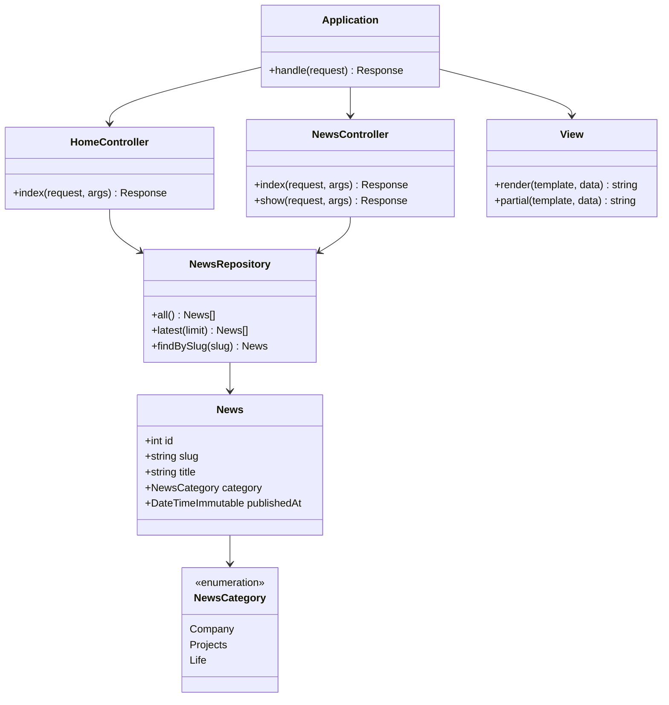
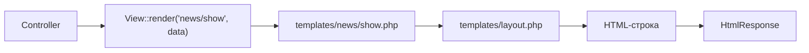
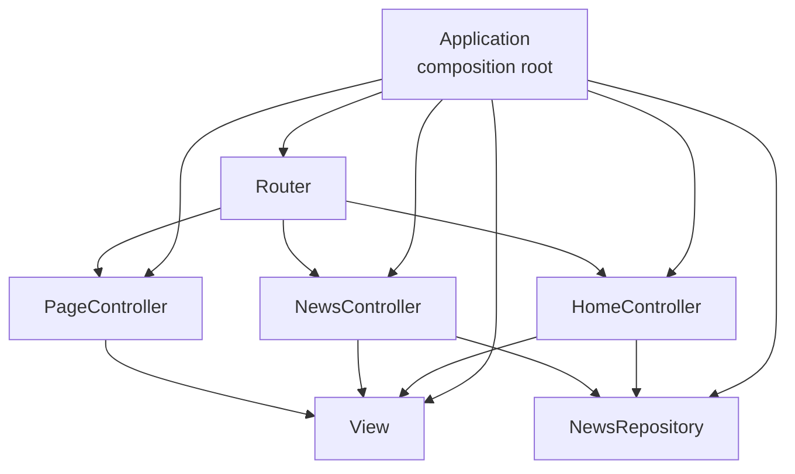
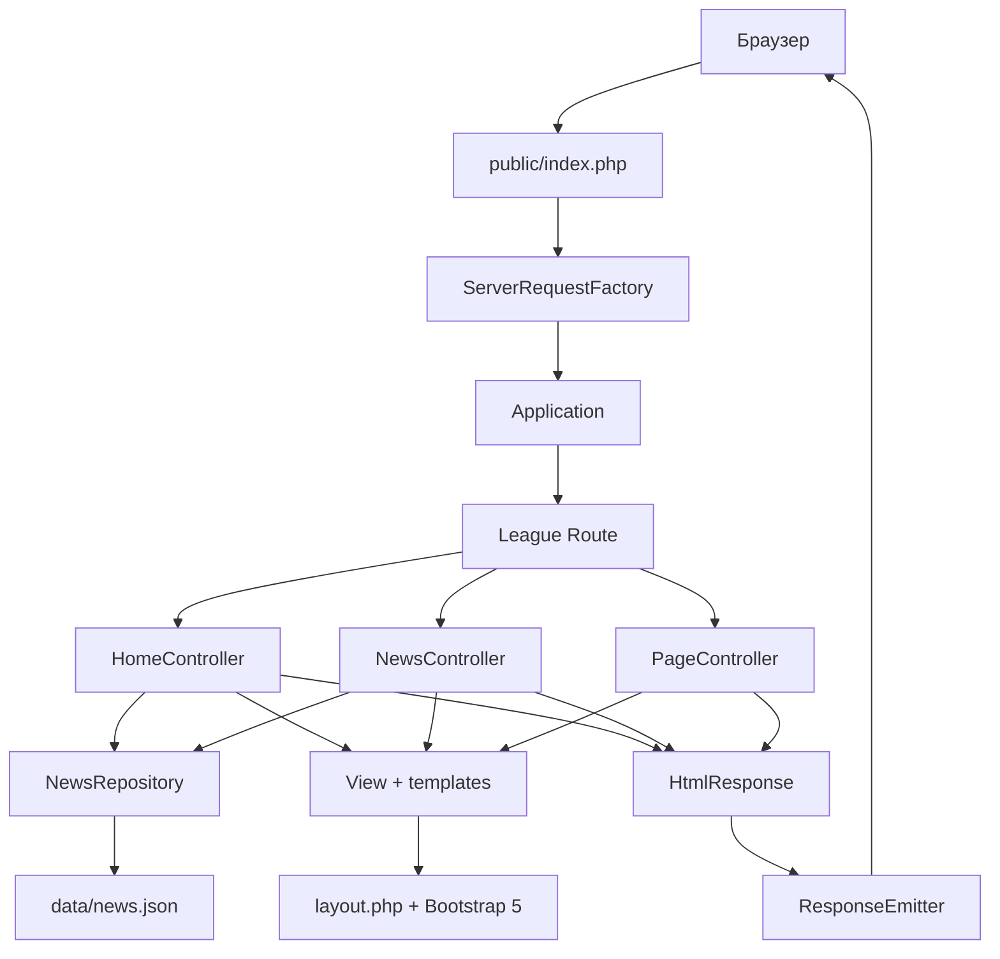

# Работа 7. MVC и FrontController: сайт-визитка с новостями

В работах 1–6 приложение росло постепенно: сначала один скрипт, потом набор страниц
`index.php`, `add.php`, `edit.php`, `delete.php`. Для небольшого каталога это нормально,
но у такого устройства есть предел. Каждая страница сама читает запрос, сама загружает
данные, сама проверяет форму и сама печатает HTML. Чем больше страниц, тем больше
повторов и тем труднее понять, где заканчивается «получить данные» и начинается
«показать страницу».

В этой работе мы разложим приложение на три слоя — **модель**, **представление** и
**контроллер** — и сделаем единую точку входа. Тема проекта новая: небольшой
**сайт-визитка digital-студии с новостями**.

Материал рассчитан на **20–30 минут чтения**. Примерно столько времени займут разделы:

| Раздел | Время |
|---|---|
| 1. MVC | 5 мин |
| 2. FrontController | 4 мин |
| 3. PSR-7 | 4 мин |
| 4. League Route 7 | 5 мин |
| 5. Модель и репозиторий | 4 мин |
| 6. Views и Bootstrap | 3 мин |
| 7. Ручное DI без контейнера | 3 мин |
| 8. Ошибки и ответ | 2 мин |

---

## 1. Что такое MVC

### 1.1. Проблема «страниц-скриптов»

Представим страницу новости. В процедурном стиле она может выглядеть так:

```php
<?php
$news = json_decode(file_get_contents('data/news.json'), true);
$item = null;

foreach ($news as $row) {
    if ($row['slug'] === $_GET['slug']) {
        $item = $row;
    }
}

if ($item === null) {
    http_response_code(404);
    echo 'Новость не найдена';
    exit;
}

?><!DOCTYPE html>
<html>
<body>
    <h1><?= htmlspecialchars($item['title']) ?></h1>
    <p><?= nl2br(htmlspecialchars($item['body'])) ?></p>
</body>
</html>
```

Здесь в одном файле смешано всё:

- **получение данных** — чтение JSON, поиск новости;
- **логика запроса** — проверка параметра `slug`, ответ 404;
- **вывод** — HTML, заголовок, абзацы.

Пока файл один, это терпимо. Но стоит добавить список новостей, главную страницу и
контакты — и одинаковый код чтения JSON начнёт копироваться. А если завтра данные
переедут из JSON в базу или API, придётся менять каждую страницу.

### 1.2. Три роли

**MVC** (Model–View–Controller) — это способ разделить ответственность:

| Слой | Что делает | Чего не делает |
|---|---|---|
| **Model** | Описывает предметную область и правила: новость, категория, репозиторий | Не печатает HTML и не читает `$_GET` |
| **View** | Превращает данные в HTML по шаблону | Не ходит в файл/базу и не решает, какой маршрут сработал |
| **Controller** | Принимает запрос, вызывает модель, выбирает view и возвращает ответ | Не содержит SQL/JSON-парсинга и больших кусков HTML |

Модель в этой работе — это не только «объект новости», но и **репозиторий**, который
умеет отдать новости. View — набор PHP-шаблонов. Controller — небольшой класс, который
связывает запрос и модель.



Контроллер — дирижёр. Он не играет на всех инструментах сам, а решает, кого позвать и
в каком порядке.

### 1.3. Границы ответственности

Полезно запомнить три запрета:

1. **Модель не знает про HTTP.** У `News` нет методов `isPost()` или `redirect()`.
2. **View не знает, откуда данные.** Шаблон получает готовый объект `$news` и просто
   выводит его поля.
3. **Controller не верстает страницу целиком.** Он выбирает шаблон и передаёт данные,
   а разметка живёт в `templates/`.

Такое разделение даёт главное: каждую часть можно менять отдельно. Заменили JSON на
базу — контроллер и шаблоны не изменились. Переделали дизайн — модель и репозиторий
не тронуты.

---

## 2. FrontController

### 2.1. Одна дверь вместо десяти

В работах 3–6 у нас было много точек входа: `index.php`, `add.php`, `edit.php`,
`delete.php`. Веб-сервер сам выбирал файл по адресу. Это называется **page controller**:
на каждую страницу — свой скрипт.

**FrontController** — противоположный подход: все запросы приходят в один файл
`public/index.php`. Дальше этот файл решает, какой код вызвать.



Плюсы FrontController:

- один вход — одно место для общих настроек, обработки ошибок и заголовков;
- маршруты описаны в одном файле, их видно целиком;
- легко добавить middleware: логирование, авторизацию, кэш;
- структура URL не зависит от имён файлов на диске.

### 2.2. Полный жизненный цикл запроса



Обратите внимание: контроллер не печатает HTML через `echo`. Он возвращает **объект
ответа**. Печать — задача отдельного «эмиттера» в самом конце.

### 2.3. Точка входа

```php
<?php

declare(strict_types=1);

use App\Application;
use App\Http\ResponseEmitter;
use Laminas\Diactoros\ServerRequestFactory;

require dirname(__DIR__) . '/vendor/autoload.php';

$request = ServerRequestFactory::fromGlobals(
    $_SERVER,
    $_GET,
    $_POST,
    $_COOKIE,
    $_FILES
);

$application = new Application(dirname(__DIR__));
$response = $application->handle($request);

(new ResponseEmitter())->emit($response);
```

Файл короткий намеренно. Вся сборка приложения спрятана в `Application`, а здесь только
«взять запрос — отдать ответ».

---

## 3. PSR-7: запрос и ответ как объекты

### 3.1. Зачем объекты вместо суперглобальных массивов

В процедурном коде мы работали с `$_GET`, `$_POST`, `$_SERVER`. Это глобальные массивы:
их можно случайно изменить в любом месте, их неудобно передавать в тесты, у них нет
типов.

**PSR-7** описывает HTTP-сообщения как объекты:

- `ServerRequestInterface` — входящий запрос;
- `ResponseInterface` — ответ;
- `StreamInterface` — тело сообщения;
- `UriInterface` — адрес.

В этой работе используется реализация **Laminas Diactoros**. Она создаёт объекты из
глобальных массивов и умеет отдавать HTML-ответ.

### 3.2. Создание запроса

```php
use Laminas\Diactoros\ServerRequestFactory;

$request = ServerRequestFactory::fromGlobals(
    $_SERVER,
    $_GET,
    $_POST,
    $_COOKIE,
    $_FILES
);

$path   = $request->getUri()->getPath();   // /news/novyj-ofis
$method = $request->getMethod();           // GET
$query  = $request->getQueryParams();      // ['page' => '2']
```

В тестах такой объект можно создать руками, без веб-сервера:

```php
$request = new Laminas\Diactoros\ServerRequest(
    uri: 'https://example.test/news',
    method: 'GET'
);
```

### 3.3. Создание ответа

```php
use Laminas\Diactoros\Response\HtmlResponse;

$response = new HtmlResponse('<h1>Привет</h1>', 200);

$response->getStatusCode();          // 200
$response->getHeaderLine('Content-Type'); // text/html; charset=utf-8
```

Для 404 достаточно другого статуса:

```php
$notFound = new HtmlResponse('<h1>Страница не найдена</h1>', 404);
```

Для редиректа есть `RedirectResponse`:

```php
use Laminas\Diactoros\Response\RedirectResponse;

return new RedirectResponse('/news');
```

### 3.4. Иммутабельность

PSR-7-объекты **неизменяемы**. Методы `withStatus()`, `withHeader()` не меняют старый
объект, а возвращают новый:

```php
$response = new HtmlResponse('OK');
$redirect = $response->withStatus(302)->withHeader('Location', '/news');

// $response по-прежнему имеет статус 200
```

Это защищает от неожиданных изменений: если объект передали в другую функцию, она не
сможет тайно испортить ответ.

---

## 4. Маршрутизация: League Route 7

### 4.1. Установка

```bash
composer require league/route:^7.0
composer require laminas/laminas-diactoros:^3.9
```

Route 7 требует PHP 8.3+ и работает с PSR-7. Diactoros даёт реализации запроса и ответа.

### 4.2. Простой маршрут

```php
use League\Route\Router;
use Psr\Http\Message\ResponseInterface;
use Psr\Http\Message\ServerRequestInterface;

$router = new Router();

$router->get('/', function (ServerRequestInterface $request): ResponseInterface {
    return new Laminas\Diactoros\Response\HtmlResponse('<h1>Главная</h1>');
});
```

Контроллер получает два аргумента:

1. `ServerRequestInterface $request` — запрос;
2. `array $args` — параметры из адреса (может быть пустым).

Возвращать нужно `ResponseInterface`.

### 4.3. Параметры в адресе

```php
$router->get('/news/{slug:slug}', function (
    ServerRequestInterface $request,
    array $args
): ResponseInterface {
    $slug = $args['slug'];
    // ...
});
```

`{slug:slug}` означает «сегмент с именем `slug`, проверенный встроенным шаблоном
`slug`». В Route есть и другие шаблоны: `number`, `word`, `alphanum_dash`, `uuid`.
Можно задать регулярное выражение: `{id:[0-9]+}`.

### 4.4. Группы и имена маршрутов

```php
$router->group('/admin', function ($group): void {
    $group->get('/news', [AdminController::class, 'index'])->setName('admin.news');
});

$router->get('/news/{slug:slug}', [$news, 'show'])->setName('news.show');

$url = $router->generateUrl('news.show', ['slug' => 'novyj-ofis']);
// /news/novyj-ofis
```

Имена пригодятся, когда ссылки появятся в шаблонах: путь меняется в одном месте, а
`generateUrl()` собирает корректный адрес.

### 4.5. Как Router выбирает маршрут



В этой работе используется стандартная `ApplicationStrategy`: контроллер получает
`request` и `args`, а если маршрут не найден, Route бросает
`League\Route\Http\Exception\NotFoundException`. Мы ловим это исключение в
`Application` и показываем красивую страницу 404.

---

## 5. Модель и репозиторий

### 5.1. Модель `News`

Модель описывает новость и её правила. В нашем проекте это `readonly`-класс: после
создания его нельзя изменить.

```php
final readonly class News
{
    public function __construct(
        public int $id,
        public string $slug,
        public string $title,
        public NewsCategory $category,
        public string $excerpt,
        public string $body,
        public DateTimeImmutable $publishedAt,
    ) {
    }

    public static function fromArray(array $row): self
    {
        // JSON -> объект, с проверкой категории и даты
    }

    public function formattedDate(): string
    {
        return $this->publishedAt->format('d.m.Y');
    }
}
```

Категория — это `enum`, а не строка. Опечатка `'compani'` не пройдёт:

```php
enum NewsCategory: string
{
    case Company = 'company';
    case Projects = 'projects';
    case Life = 'life';
}
```

### 5.2. Зачем репозиторий

Репозиторий — это «склад» объектов. Контроллеру не важно, лежат новости в JSON, в базе
или приходят из API. Ему нужны методы:

```php
$repository->all();                 // все новости
$repository->latest(3);             // три последние
$repository->findBySlug($slug);     // одна новость или null
```

Внутри `NewsRepository` читает `data/news.json`, проверяет JSON и превращает строки в
объекты `News`. Это **mock-данные**: базы нет, но граница уже проведена правильно.
Позже можно написать `ApiNewsRepository` с теми же методами и заменить реализацию.



### 5.3. Ошибки данных

Если файла нет или JSON испорчен, репозиторий бросает `RuntimeException`. Это не
«пользовательская» ошибка, а проблема конфигурации. `Application` ловит её и отдаёт 500.
Пользователь не должен видеть путь к файлу и стек вызовов — только понятное сообщение.

---

## 6. Views: шаблоны, layout и Bootstrap 5

### 6.1. Как работает рендеринг

View — это класс, который умеет превратить имя шаблона и данные в строку HTML.

```php
$html = $view->render('news/show', [
    'title' => $news->title,
    'active' => 'news',
    'news' => $news,
]);
```

Внутри:

1. открывается буфер вывода (`ob_start`);
2. подключается файл `templates/news/show.php`;
3. всё, что он вывел, возвращается строкой (`ob_get_clean`);
4. готовая строка вставляется в `templates/layout.php` как `$content`.



### 6.2. Layout и partials

**Layout** — общая рамка сайта: `<head>`, навигация, подвал, подключение Bootstrap.
Отдельная страница отвечает только за свою середину.

**Partial** — маленький повторяемый кусок, например карточка новости:

```php
<?= $view->partial('partials/news-card', ['news' => $news]) ?>
```

Карточка используется и на главной, и в списке новостей — верстка не дублируется.

### 6.3. Экранирование

Любые данные, попавшие в HTML, выводятся через `Html::e()`:

```php
<h1><?= Html::e($news->title) ?></h1>
```

`Html::e()` — обёртка над `htmlspecialchars(..., ENT_QUOTES, 'UTF-8')`. Она превращает
`<script>` в безопасный текст. Даже если новость пришла из ненадёжного источника,
сломать страницу не получится.

Правило простое: **в шаблоне нет `<?= $переменная ?>` без экранирования**. Исключение —
`$content` в layout: это уже готовый HTML, который собрал наш же View.

### 6.4. Bootstrap 5

Bootstrap подключается с CDN в layout:

```html
<link href="https://cdn.jsdelivr.net/npm/bootstrap@5.3.3/dist/css/bootstrap.min.css" rel="stylesheet">
```

Готовые классы (`container`, `row`, `col`, `card`, `navbar`, `badge`, `btn`) ускоряют
вёрстку и дают адаптивность без собственного CSS. Собственного CSS в проекте минимум:
только hero-блок и небольшие штрихи.

---

## 7. Внедрение зависимостей без PSR-11

### 7.1. Что такое зависимость

`NewsController` не может работать без репозитория и View. Эти объекты — его
**зависимости**. Вместо того чтобы создавать их внутри:

```php
// плохо: контроллер сам создаёт зависимости
public function __construct()
{
    $this->repository = new NewsRepository(__DIR__ . '/../../data/news.json');
}
```

мы передаём их снаружи:

```php
// хорошо: зависимости приходят готовыми
public function __construct(
    private readonly View $view,
    private readonly NewsRepository $repository,
) {
}
```

Это называется **внедрение зависимостей** (dependency injection, DI). В тестах можно
передать другой репозиторий или другой View — контроллер не заметит.

### 7.2. Composition root

Где создаются все объекты? В одном месте — в `Application`. Это **composition root**
(«корень сборки»):

```php
$view = new View($basePath . '/templates', ['site' => $site]);
$repository = new NewsRepository($basePath . '/data/news.json');

$home = new HomeController($view, $repository);
$news = new NewsController($view, $repository);
$pages = new PageController($view);

$router = new Router();
$router->get('/', [$home, 'index']);
$router->get('/news', [$news, 'index']);
$router->get('/news/{slug:slug}', [$news, 'show']);
$router->get('/about', [$pages, 'about']);
$router->get('/contacts', [$pages, 'contacts']);
```



### 7.3. Почему без PSR-11

PSR-11 — стандарт **контейнера** зависимостей. Контейнер умеет автоматически создавать
объекты по имени класса и подставлять зависимости. Это удобно в больших проектах, но
скрывает, откуда что берётся.

По условию работы контейнер **не используем**. Вместо него — явные `new` в
`Application`. Плюсы:

- видно всю картину зависимостей на одном экране;
- нет «магии» и неожиданных ошибок вида «сервис не зарегистрирован»;
- проще понять, что именно получает контроллер;
- для проекта из десяти классов контейнер действительно не нужен.

Важно: Route 7 **умеет** работать с PSR-11, но мы не передаём ему контейнер и
регистрируем контроллеры как готовые объекты.

---

## 8. Ошибки и отдача ответа

### 8.1. 404 и 500

В `Application::handle()` есть два перехвата:

```php
try {
    return $this->router->dispatch($request);
} catch (NotFoundException $error) {
    return new HtmlResponse($view->render('errors/404', ...), 404);
} catch (Throwable $error) {
    return new HtmlResponse($view->render('errors/500', ...), 500);
}
```

- `NotFoundException` Route бросает, если маршрут не найден. Мы также бросаем его
  вручную, если новость с таким `slug` отсутствует.
- Любая другая ошибка — 500. В режиме отладки (`APP_DEBUG=1`) можно показать текст
  ошибки, в обычном режиме — только общее сообщение.

### 8.2. Эмиссия PSR-7-ответа

Объект `Response` сам не отправляется в браузер. Нужно перенести его статус, заголовки и
тело в реальный HTTP-ответ. В этой работе для наглядности используется маленький
собственный `ResponseEmitter`:

```php
http_response_code($response->getStatusCode());

foreach ($response->getHeaders() as $name => $values) {
    foreach ($values as $value) {
        header($name . ': ' . $value, false);
    }
}

echo (string) $response->getBody();
```

В реальном проекте можно взять `Laminas\HttpHandlerRunner\Emitter\SapiEmitter` — он
делает то же самое, но аккуратнее обрабатывает заголовки. Для учебной работы важно
понять сам принцип: **контроллер формирует ответ, фронт-контроллер его отправляет**.

---

## 9. Собираем всё вместе

Итоговая схема приложения:



Что теперь умеет приложение:

- открывать главную страницу с последними новостями;
- показывать список новостей;
- открывать отдельную новость по `slug`;
- отдавать страницы «О нас» и «Контакты»;
- возвращать 404 для несуществующего адреса;
- не смешивать данные, разметку и обработку запроса.

---

## 10. Чек-лист перед заданием

Проверьте, что вы можете ответить на вопросы:

- [ ] Чем модель отличается от контроллера и почему модель не должна знать про `$_GET`?
- [ ] Зачем нужен FrontController и что он делает?
- [ ] Что такое PSR-7 и почему объекты запроса/ответа неизменяемы?
- [ ] Как Route 7 передаёт параметры из адреса в контроллер?
- [ ] Зачем нужен репозиторий, если можно прочитать JSON прямо в контроллере?
- [ ] Почему в шаблоне нужно экранировать каждый вывод?
- [ ] Что такое composition root и почему в этой работе нет PSR-11-контейнера?

Если ответы находятся — переходите к `zadanie.md`: там мы соберём это приложение
по шагам.
